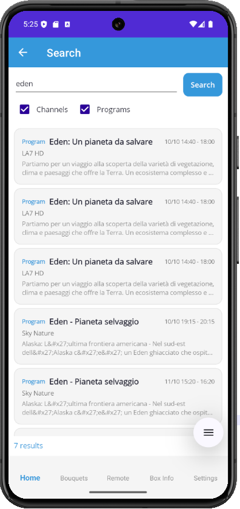

# Enigma2Webif

> Android app to control your Enigma2 satellite receiver remotely — a modern mobile client for OpenWebif.

  
  

---

## 📱 About

**Enigma2Webif** is a native Android application that brings the power of [OpenWebif](https://github.com/oe-alliance/OpenWebif) to your smartphone. Control your Enigma2 decoder (Uclan, Vu+, Zgemma, Octagon, Dreambox, and many more) with a modern, clean and fast interface.

Built with **.NET MAUI 10** for maximum performance and native look-and-feel.

---

## ✨ Features

### 🎛️ Control
- **Multi-Box** — Save multiple receiver profiles and switch instantly
- **Remote Control** — Full virtual remote with colored buttons, numbers, playback, TV/Radio/Audio/Video
- **Power Menu** — Standby, Deep Standby, Reboot, Restart Enigma2, Wake Up
- **Sleep Timer** — Programmed shutdown

### 📺 Content
- **Bouquets & Channels** — Browse all your favorites with live EPG Now info
- **EPG Guide** — Full program guide with details
- **Global Search** — Search across channels and programs at once
- **Zap** — Change channel with a single tap

### 🛠️ Tools
- **Screenshot** — Capture the box screen in real time
- **Telnet** — Direct terminal with quick commands (reboot, df, free, uptime)
- **FTP** — Browse, download, upload files; text file viewer included
- **Box Info** — Firmware, kernel, tuners, HDD, network, RAM

### 🌍 Experience
- **5 Languages** — Italian, English, German, French, Spanish (live switch)
- **Light / Dark Theme** — Follows system settings
- **Integrated Guide** — Step-by-step help for every feature
- **About Page** — Credits, source code, support links

---

## 📸 Screenshots

| Home |
|:---:|
|  |

| Bouquet | Channels |
|:---:|:---:|
|  |  |

| Search | Power Menu |
|:---:|:---:|
|  |  |

| Remote | Screenshot |
|:---:|:---:|
|  |  |

| Epg | Settings |
|:---:|:---:|
|  |  |

| Telnet | Ftp |
|:---:|:---:|
|  |  |

| Boxinfo | Boxinfo |
|:---:|:---:|
|  |  |

| About | Guida |
|:---:|:---:|
|  |  |

---

## 🚀 Installation

### Requirements
- Android 8.0 (API 26) or higher
- Enigma2 receiver with OpenWebif enabled
- Same Wi-Fi network as your box

### Download
1. Download the latest APK from the **Releases** section
2. On your phone, enable **Install from unknown sources** for your file manager
3. Open the APK and install
4. Launch the app

### First Setup
1. Open **Settings** tab
2. Tap `+` to add a new box profile
3. Enter:
   - **Name** (e.g. "Living Room")
   - **IP Address** (e.g. `192.168.1.100`)
   - **Ports** (default: HTTP 80, Telnet 23, FTP 21)
   - **Username** (default: `root`)
   - **Password** (your box password)
4. Tap **Save**, then **Test Connection**

---

## 📖 User Guide

### 🏠 Home
The starting point. Shows:
- **Box name** and **connection status**
- **Current channel** with program info
- **Quick tiles** to every feature

Tap the ⟳ button to refresh status.

### 📺 Bouquets & Channels
1. Open **Bouquet** tab
2. Tap a bouquet to see its channels
3. Each channel shows the current program (EPG Now)
4. **Tap a channel** → immediate zap
5. **Tap the EPG button** → full program guide for that channel

### 🔍 Search
- Search channels and programs at the same time
- Toggle **Channels** / **Programs** with checkboxes
- Tap a channel to zap, tap a program to open its EPG

### 🎮 Remote Control
Full virtual remote with:
- Arrow keys, OK, Menu, Info, EPG, Exit
- **Colored buttons** (Red, Green, Yellow, Blue) — contextual
- Volume / Mute / Channel +/-
- Numbers 0-9
- Playback: Rewind, Play, Pause, Stop, Forward
- TV / Radio / Audio / Video switches

### ⚡ Power Menu
- **Standby** — Low-power sleep
- **Deep Standby** — Full shutdown
- **Reboot** — Restart decoder
- **Restart Enigma2** — Restart GUI only
- **Wake Up** — Wake from standby

### 📸 Screenshot
Tap **Refresh** to grab the current screen of your box.

### 💻 Telnet
Terminal access to your receiver:
- Tap **Connect**
- Type commands and press **Send**
- Or use **quick buttons**: reboot, restart enigma2, df -h, free, uptime, ls, ps, ifconfig

### 📁 FTP
File manager for your box:
- Tap **Connect**
- Tap folders to enter, `⬆` to go up
- Tap text files (.txt, .sh, .cfg, .json) to view them
- Download and upload supported

### ℹ️ Box Info
Full system dashboard:
- Brand, Model, Chipset
- Firmware, Image, Kernel, Enigma version
- Uptime, RAM usage
- **Tuners** with current state
- **HDD** with capacity and free space
- **Network interfaces** with IP and MAC

### ⚙️ Settings
- **Language** — Switch between IT / EN / DE / FR / ES
- **Box Profiles** — Add `+`, delete `🗑`, switch active
- **Connection** — IP, ports, credentials, HTTPS toggle

### ❓ Guide
Built-in guide with 10 sections explaining every feature.

### ℹ️ About
App info, credits, PayPal support link, GitHub repository, OpenWebif project link.

---

## 🖥️ Supported Receivers

Any Enigma2 receiver with **OpenWebif 1.5+** installed, including:

- Uclan Ustym 4K PRO / Ustym 4K
- Vu+ (Uno, Duo, Solo, Zero, Ultimo)
- Zgemma (H.Series, H7, H9, H10, H11)
- Octagon (SF4008, SF8008, SX88)
- Dreambox (DM900, DM920, DM ONE, DM TWO)
- Gigablue (Quad, UE, X3)
- Edision (OS Mio+, OS Nino+)
- Mutant, AX HD, Formuler, Amiko...

**Images tested**: OpenATV, OpenPLi, OpenBH, OpenVision, OpenEight, OpenSPA

---

## 🌍 Languages

- 🇮🇹 Italiano
- 🇬🇧 English
- 🇩🇪 Deutsch
- 🇫🇷 Français
- 🇪🇸 Español

Want to add your language? Open an issue!

---

## 🐛 Bug Reports & Feature Requests

Found a bug or have an idea? Open an issue on GitHub:

👉 [https://github.com/belfagor2005/Enigma2Webif/issues](https://github.com/belfagor2005/Enigma2Webif/issues)

Please include:
- App version
- Android version
- Receiver model + image
- Steps to reproduce
- Screenshots if possible

---

## ☕ Support Development

If you find this app useful, consider supporting the development:

👉 [PayPal — belfagor2005](https://paypal.me/belfagor2005)

Every coffee helps! ☕

---

## 📜 License

This project is licensed under the **GNU General Public License v3.0**.

See the [LICENSE](LICENSE) file for details.

---

## 🙏 Credits

- **Author**: Lululla
- **Based on**: [OpenWebif](https://github.com/oe-alliance/OpenWebif) by the OE-Alliance team
- **Icon**: Custom design
- **Special thanks** to the Enigma2 community

---

## ⚠️ Disclaimer

This app is provided "as is", without warranty of any kind. Use at your own risk.

The author is not responsible for any damage to your receiver or data loss.

Enigma2 and OpenWebif are trademarks of their respective owners. This app is not affiliated with any of them.

---

*Made with ❤️ for the Enigma2 community*
