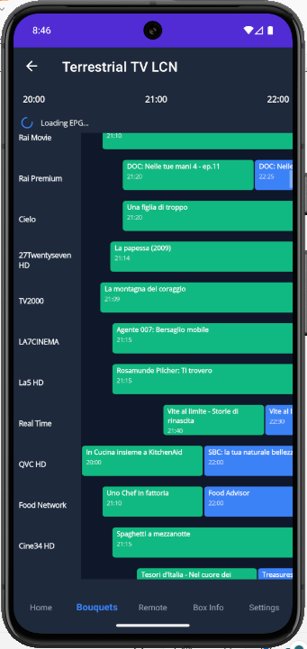

# Enigma2Webif

> Android app to control your Enigma2 satellite receiver remotely — a modern mobile client for OpenWebif.

  
  

---

## 📸 Screenshots

### 🏠 Home & Navigation
| Home (1) | Home (2) | Home (3) |
|:---:|:---:|:---:|
|  |  |  |

### 📺 Content & EPG
| Bouquet | Bouquet Editor | EPG Grid |
|:---:|:---:|:---:|
|  |  |  |

### 🎛️ Control & Remote
| Remote | Live TV |
|:---:|:---:|
|  |  |

| Timers | Registrazioni |
|:---:|:---:|
|  |  |

### 🛠️ Tools & Info
| Screenshot | Telnet | FTP |
|:---:|:---:|:---:|
|  |  |  |

| Settings (Tema + Backup) | 
|:---:|
|  |

---

## 📱 About

**Enigma2Webif** is a native Android application that brings the power of [OpenWebif](https://github.com/oe-alliance/OpenWebif) to your smartphone. Control your Enigma2 decoder (Uclan, Vu+, Zgemma, Octagon, Dreambox, and many more) with a modern, clean and fast interface.

Built with **.NET MAUI 10** for maximum performance and native look-and-feel.

---

## ✨ Features (v1.6.0)

### 🎬 Media & Streaming
- **Built-in Video Player** — Watch channels directly in the app. Includes **Picture-in-Picture** support and **Background Media Session** (Android native Play/Pause notification).
- **Local Download** — Download recordings from the box HDD to your phone via FTP, with a live progress bar.
- **Live TV** — Transcoding profiles (Low/Medium/High/HD), Subservices support.
- **Media Player** — Browse HDD via FTP, play on TV (`zap`) or on phone.
- **Unified Recordings** — A single page with full movie list, tags, locations, rename, move, copy, delete, download. **Multi-Select** mode for batch operations.
- **Audio & Subtitles** — Real-time track switching.

### 🎛️ Control
- **Advanced Remote** — Physical layout, short/long press, haptic feedback (vibration).
- **Button Setup** — Assign native Enigma2 actions to hardware keys.
- **Power Menu** — Standby, Deep Standby, Reboot, Restart, Wake Up, WOL, Power Timer, HDMI-CEC.
- **Sleep Timer** — Programmed shutdown.
- **OSD Messages** — Popup to TV.
- **Signal Finder** — SNR/AGC/BER graph + audio beep (with OpenATV AGC estimation fix).
- **Parental Control** — PIN-protected channels.

### 📺 Content & Editing
- **Edit Mode (Bouquets & Channels)** — New dedicated "Edit" button in the header. Reorder (Up/Down), Rename, or Delete items without cluttering the swipe menu.
- **EPG Grid (Palimpsest)** — 2D guide with JSON cache (5 min).
- **Plugin Manager** — FTP scan + AutoTimer and EPGRefresh editors.
- **Global Search** — Channels + Programs in parallel with **Advanced Filters** (Movies, Sports, News). **Voice search** via native Android microphone.
- **Export** — **M3U** (IPTV only) saved locally and shared natively, or XSPF.

### ⏰ Automation
- **Timer Notifications** — Get a push notification before a timer starts and **when it ends/fails**.
- **Home Assistant Webhook** — Send events to your domotics system when you change channel or start a recording. Includes a test link in Settings (`webhook.site`).
- **Widget Home Screen** — Shows current channel and EPG description on your home screen.

### 🛠️ Tools & System
- **In-App Update Checker** — Automatic check via GitHub API on startup (3s delay) and manual check in Settings.
- **Backup & Restore** — Export/Import all settings (boxes, remote keys, parental list) to a JSON file.
- **Local Cache (SQLite)** — Channels and EPG saved locally. App opens instantly even when the box is offline.
- **Screenshot** — Modes (All/Video/OSD), formats (JPG/PNG), resolutions.
- **Telnet, FTP, Box Info, System Info**.

### 🎨 Experience
- **Light / Dark Theme** — Follow system or manual choice.
- **Haptic Feedback** — Remote keys vibrate on press.
- **5 Languages** — IT, EN, DE, FR, ES (100% translated, no hardcoded strings).
- **Integrated Guide** — 43 sections covering every feature.

---

## 🚀 Installation

1. Download the latest APK from the **Releases** section.
2. Enable **Install from unknown sources**.
3. Open the APK and install.
4. Launch the app and configure your box in **Settings**.

---

## 🖥️ Supported Receivers

Any Enigma2 receiver with **OpenWebif 1.5+** installed (Uclan, Vu+, Zgemma, Octagon, Dreambox, Gigablue, Edision...).
**Images tested**: OpenATV, OpenPLi, OpenBH, OpenVision, OpenEight, OpenSPA.

---

## ☕ Support Development

If you find this app useful, consider supporting the development:

👉 [PayPal — belfagor2005](https://paypal.me/belfagor2005)
👉 [Ko-Fi — lululla](https://ko-fi.com/lululla)

---

## 📜 License

GNU General Public License v3.0.

---

*Made with ❤️ for the Enigma2 community*
