# Enigma2Webif

> Android app to control your Enigma2 satellite receiver remotely — a modern mobile client for OpenWebif.


<p align="center">
  <a href="https://ko-fi.com/lululla">
    
  </a>
  <a href="https://paypal.me/belfagor2005">
    
  </a>
</p>

---

## 📸 Screenshots

### 🏠 Home & Navigation
| Home (1) | Home (2) | Home (3) |
|:---:|:---:|:---:|
| 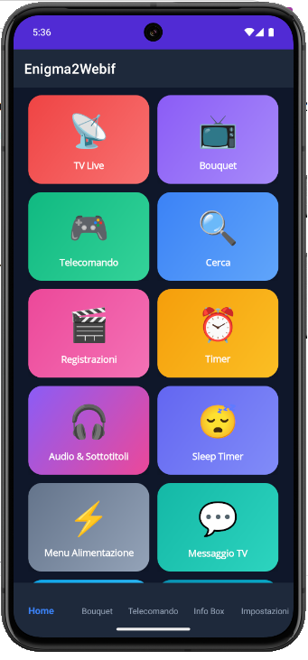 | 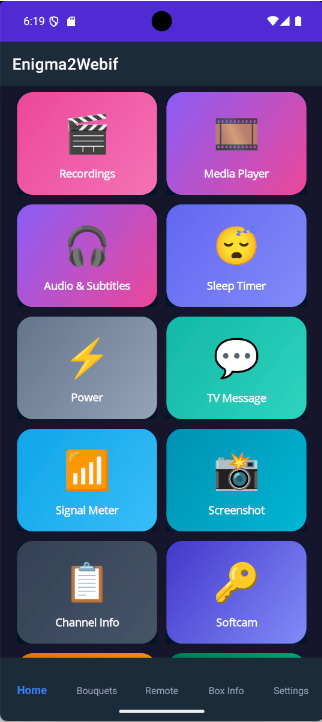 | 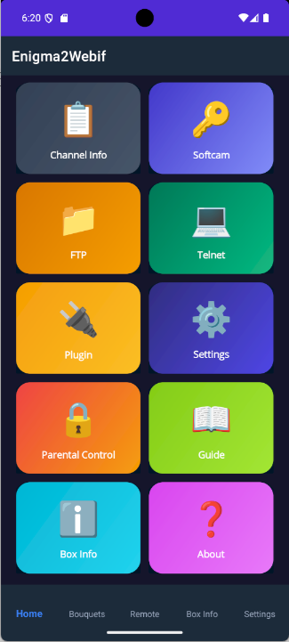 |

### 📺 Content & EPG
| Bouquet | Channels | EPG |
|:---:|:---:|:---:|
| 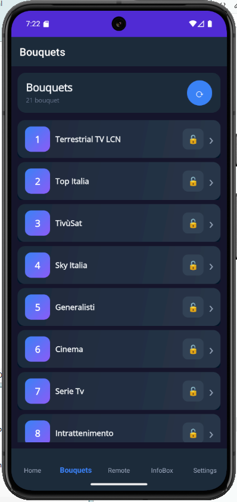 | 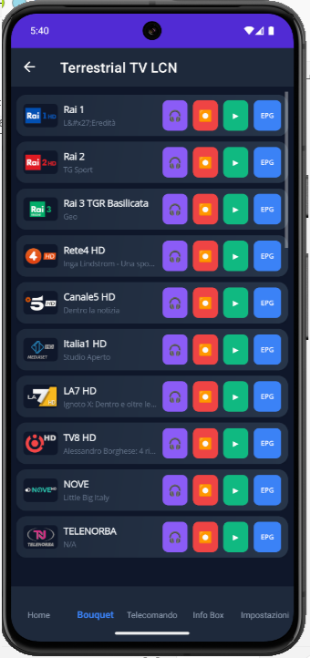 | 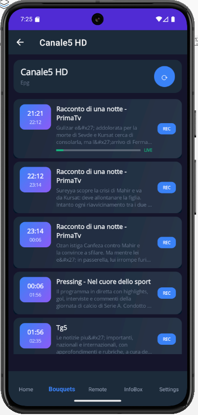 |

| Channel Info | Search | Live TV |
|:---:|:---:|:---:|
| 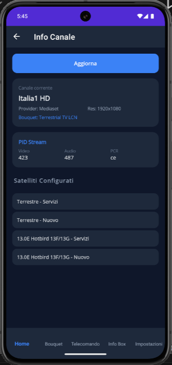 | 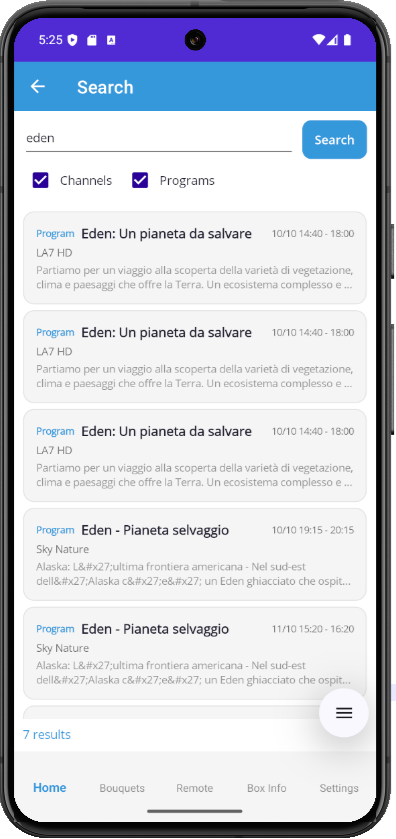 | 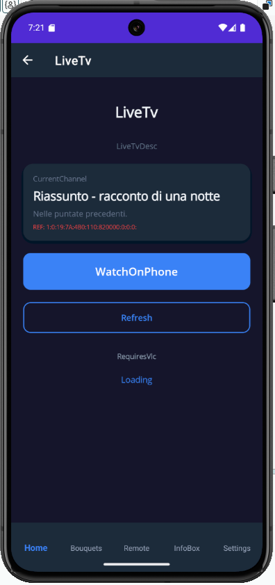 |

| Audio & Subtitles | Recordings | Settings |
|:---:|:---:|:---:|
| 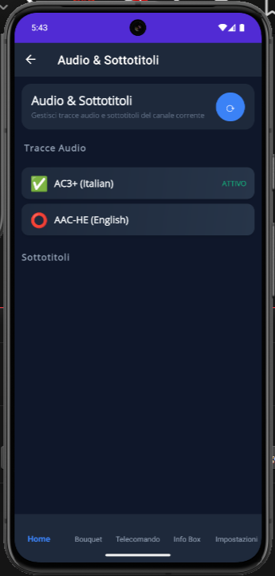 | 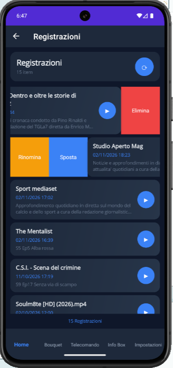 | 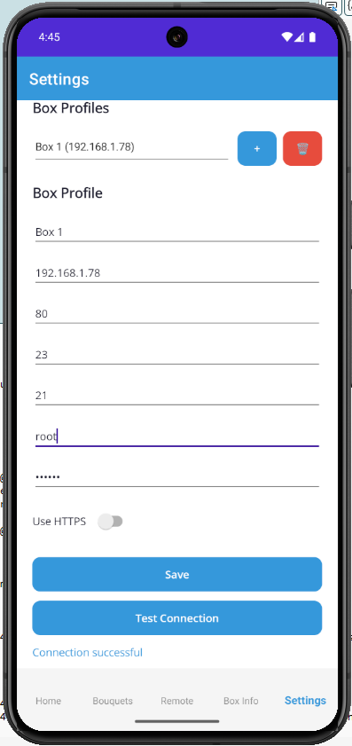 |

### 🎛️ Control & Remote
| Remote | Remote Settings (1) | Remote Settings (2) |
|:---:|:---:|:---:|
| 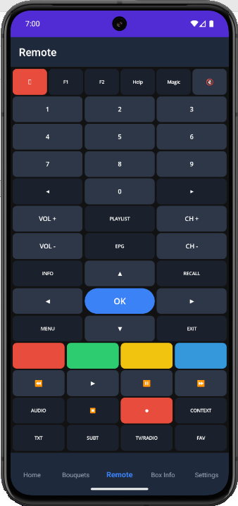 | 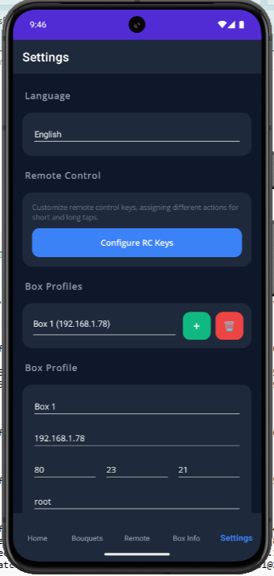 | 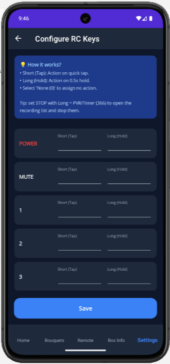 |

| Power Menu | Sleep Timer | Signal Meter |
|:---:|:---:|:---:|
| 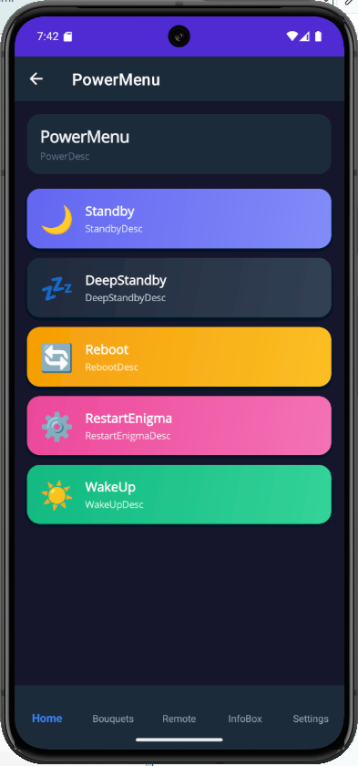 | 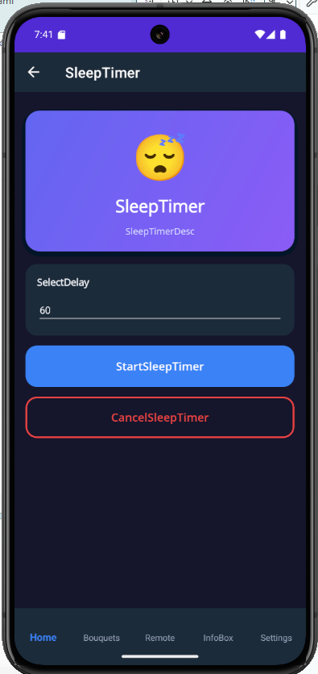 | 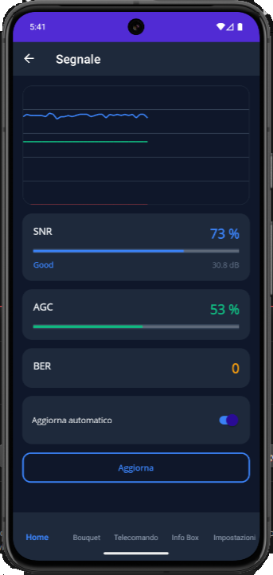 |

| OSD Message | Parental Control | Mediaplayer |
|:---:|:---:|:---:|
| 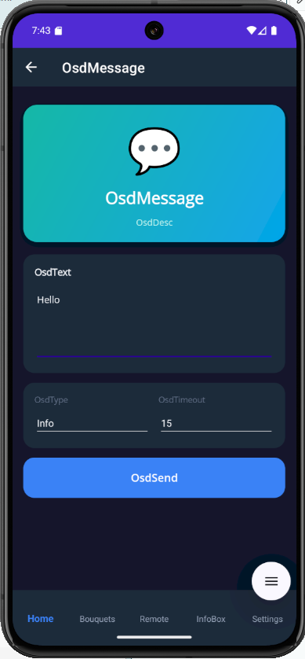 | 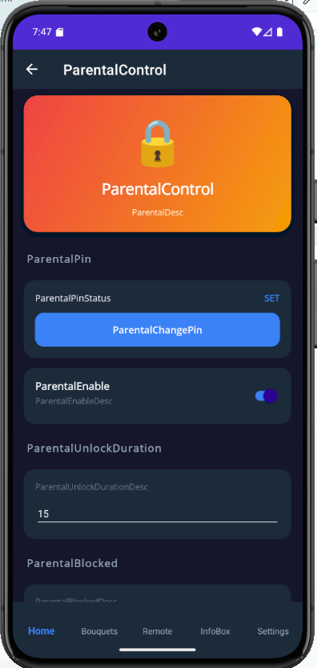 | 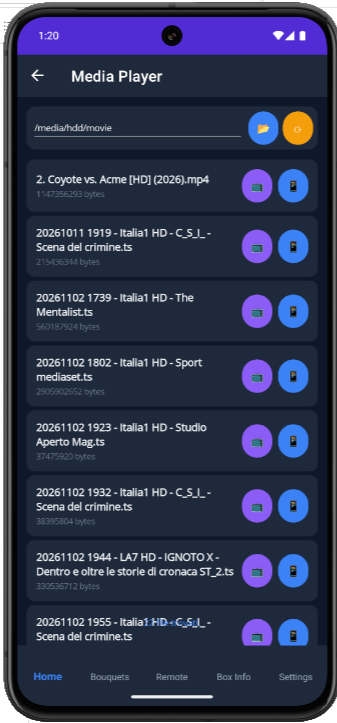 |

| Bouquet Edit | Timers (1) | Timers (2) |
|:---:|:---:|:---:|
| 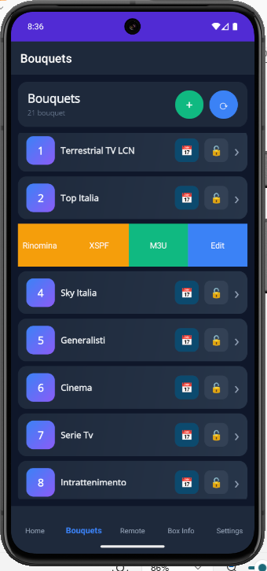 | 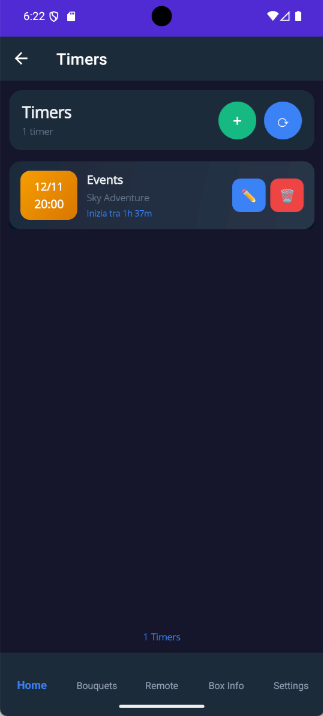 | 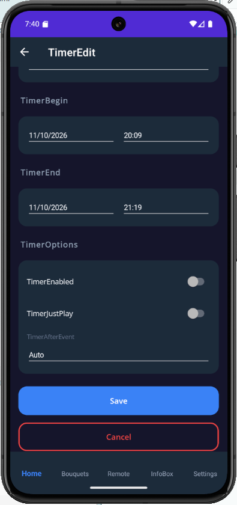 | 

### 🛠️ Tools & Info
| Screenshot | Telnet | FTP |
|:---:|:---:|:---:|
| 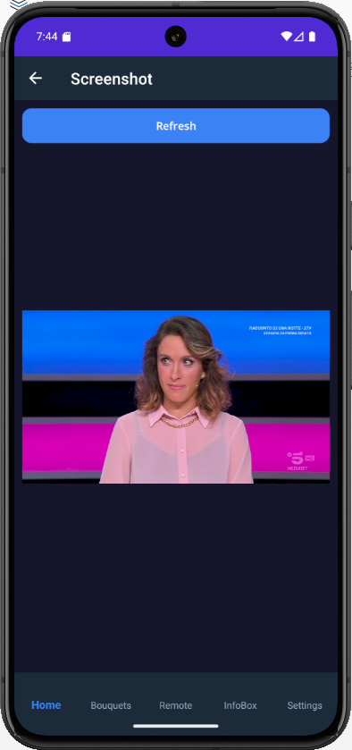 | 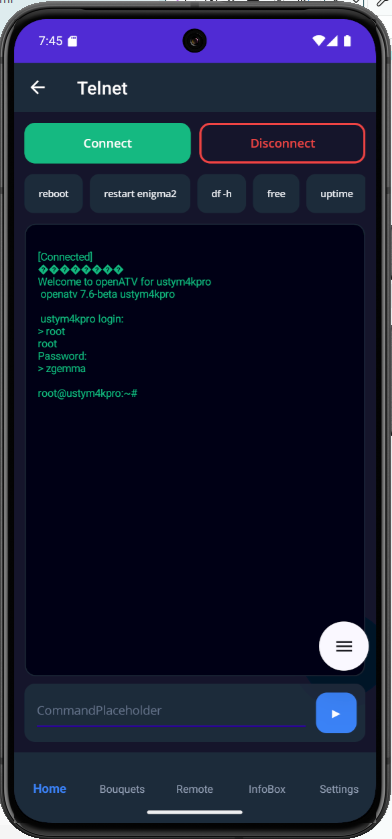 | 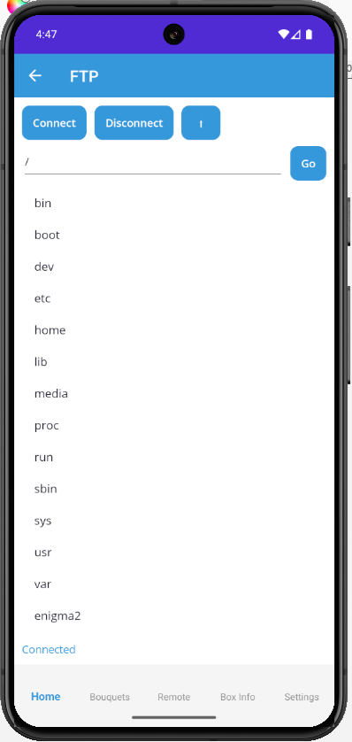 |

| Box Info (1) | Box Info (2) | Guide |
|:---:|:---:|:---:|
| 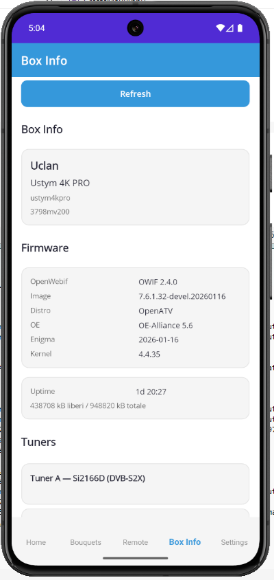 | 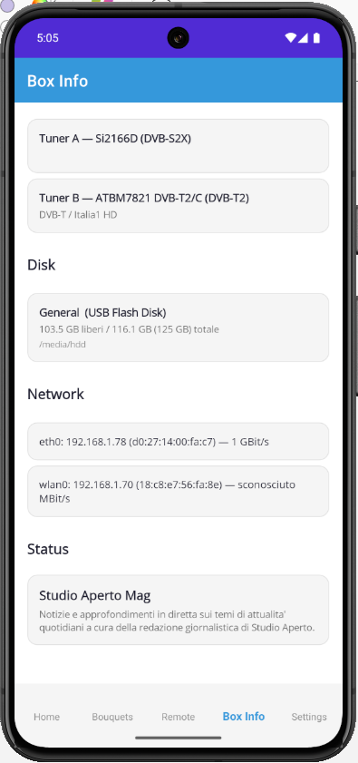 | 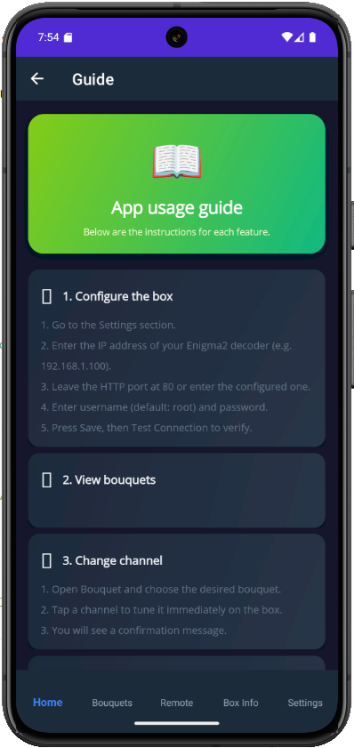 |

| About | | |
|:---:|:---:|:---:|
| 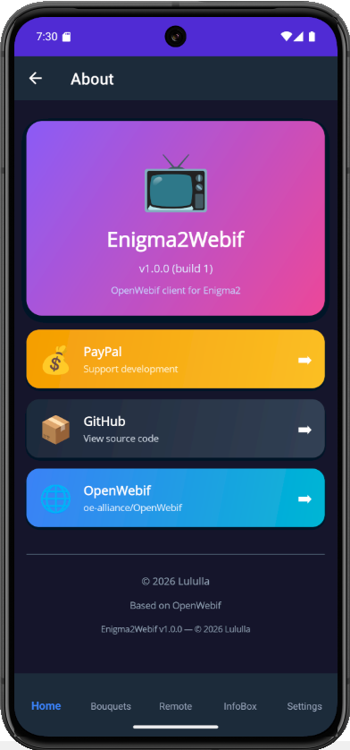 | | |


## 📱 About

**Enigma2Webif** is a native Android application that brings the power of [OpenWebif](https://github.com/oe-alliance/OpenWebif) to your smartphone. Control your Enigma2 decoder (Uclan, Vu+, Zgemma, Octagon, Dreambox, and many more) with a modern, clean and fast interface.

Built with **.NET MAUI 10** for maximum performance and native look-and-feel.

---

## ✨ Features

### 🎛️ Control
- **Multi-Box** — Save multiple receiver profiles with encrypted passwords (SecureStorage).
- **Physical Layout Remote** — A completely redesigned, scroll-free virtual remote that mirrors a real Enigma2 remote.
- **Short/Long Press** — Native support for `type=long` API. Hold any key to trigger Enigma2's native long-press actions (just like DreamDroid).
- **Button Setup** — Assign native Enigma2 actions (plugins, scripts, menus) directly to hardware keys. The app writes to `/etc/enigma2/settings` and reboots Enigma2.
- **Text Input** — Send free text to the box (useful for YouTube/Netflix searches).
- **Power Menu** — Standby, Deep Standby, Reboot, Restart Enigma2, Wake Up, **Wake on LAN**.
- **Power Timer** — Schedule box power on/off.
- **HDMI-CEC (Skip TV)** — Power on the box without turning on the TV.
- **Sleep Timer** — Programmed shutdown with configurable delay (native API).
- **OSD Messages** — Send popup messages to the TV screen.
- **Advanced Signal Finder** — Live JSON graph (SNR/AGC/BER) + Audio Metal Detector beep.
- **Parental Control** — PIN-protected channels & bouquets.

### 📺 Content & Editing
- **Bouquet Editor** — Create, delete, and rename bouquets. Move, rename, add, or remove channels. Add markers (separators) to organize your lists. All synced instantly with the box.
- **Bouquets & Channels** — Lazy Loading, Picon support, EPG Now, and a **Now/Next guide** per bouquet.
- **EPG Guide** — Full guide with Event Details Page, "Find Similar Programs", and REC button.
- **Export** — Export bouquets as M3U or XSPF via Swipe.
- **Audio & Subtitles** — Real-time track switching. Subservices support (multistream).
- **Global Search** — Search channels and programs simultaneously.
- **Timers** — Advanced creation and editing (justplay, tags, target folder, always zap, allow duplicate).

### 🛠️ Tools
- **Screenshot** — Capture the box screen in real time.
- **Telnet** — Direct terminal with quick commands.
- **FTP** — Browse, download, upload files.
- **Box Info** — Firmware, kernel, chipset, tuners, HDD, network, RAM.

### 🎬 Streaming & Media
- **Live TV** — Watch the current channel via VLC (transcoded stream on port 8001).
- **Media Player** — Browse your box HDD via FTP and play media files directly on your TV or phone.
- **Advanced Recordings** — Full Movie List across all locations, Rename, Delete, Move, Copy, and **Tag management**.

### 🌍 Experience
- **5 Languages** — Italian, English, German, French, Spanish (live switch).
- **Daily Support Prompt** — A daily, dismissible prompt asking for a coffee donation (can be permanently disabled).
- **Dark Theme** — Forced dark mode with modern gradient UI.
- **Integrated Guide** — 30+ sections explaining every feature.

---

## 🚀 Installation

1. Download the latest APK from the **Releases** section.
2. Enable **Install from unknown sources**.
3. Open the APK and install.
4. Launch the app and configure your box in **Settings**.

---

## 📖 User Guide (Highlights)

- **New Remote**: The remote now mimics a physical Enigma2 remote. Hold a key for 0.5s to send a `type=long` command.
- **Button Setup**: Go to Settings -> Configure Box Keys to map scripts or plugins to specific buttons.
- **Bouquet Editor**: Swipe left on a bouquet in the Bouquet tab to Edit, Rename, or Delete it. Inside the editor, use the arrows to move channels or add markers.
- **Signal Finder**: Activate the "Beep Audio" toggle to align your dish like a metal detector. The frequency increases with the SNR.
- **Advanced Recordings**: Swipe left on a recording to Copy, Add Tag, or Remove Tag. Manage recording folders (Locations) via the top menu.
- **Now on TV**: Click the 🕒 icon in the Channels list to see what's playing on all channels in that bouquet.
- **Power Timer & CEC**: Schedule wake-ups or use "Power on without TV" to avoid waking the TV via HDMI-CEC.
- **Media Player**: Go to Media Player, enter the folder path (e.g., `/media/hdd/movie`), and press 📂. Use 📺 to play on TV or 📱 to play on your phone.

---

## 🖥️ Supported Receivers

Any Enigma2 receiver with **OpenWebif 1.5+** installed (Uclan, Vu+, Zgemma, Octagon, Dreambox, Gigablue, Edision...).
**Images tested**: OpenATV, OpenPLi, OpenBH, OpenVision, OpenEight, OpenSPA.

---

## ☕ Support Development

If you find this app useful, consider supporting the development:

👉 [PayPal — belfagor2005](https://paypal.me/belfagor2005)
👉 [Ko-Fi — belfagor2005](https://ko-fi.com/lululla)

---

## 📜 License

GNU General Public License v3.0.

---

*Made with ❤️ for the Enigma2 community*
```
