# Enigma2Webif

> Android app to control your Enigma2 satellite receiver remotely — a modern mobile client for OpenWebif.

  
  

---

## 📱 About

**Enigma2Webif** is a native Android application that brings the power of [OpenWebif](https://github.com/oe-alliance/OpenWebif) to your smartphone and Android TV.

Control your Enigma2 decoder (Uclan, Vu+, Zgemma, Octagon, Dreambox, and many more) with a modern, clean and fast interface. Built with **.NET MAUI 10** for maximum performance and native look-and-feel.

---

## 🆕 What's new in v1.8.6

- 🎤 **Voice control, complete**: choose the **language you speak** (independent from the app language), a **"Voice commands" page** that always matches what the app understands, a **voice shortcut on the app icon**, and **app pages by voice** with the prefix *app* ("app timers", "app settings"…).
- 📲 **Home-screen widgets**: **Voice** and **Remote** widgets that slide open (▶ / ◀) and work **without opening the app** — mic, volume, mute, power, CH−/CH+, pause, play.
- 📥 **Recording downloads in the background**: notification with progress, **queue** shown under the progress bar, **skip** the current file or **cancel all**, files saved in `Download/Enigma2Webif`.
- ⏸️ **Live pause**: the **⏭ LIVE** button in the Remote jumps back to the live picture after a pause (timeshift).
- ⏰ **Timer overlap warning**: before you create a recording that overlaps others, the app tells you which ones.
- 📅 **EPG Grid "Prime time"**: one tap to see what is on at 21:00 on every channel of the bouquet; a second row of buttons keeps the toolbar clean.
- 🌍 **Remote access**: use the box away from home with a VPN or a DDNS address; the app switches by itself between local and remote.
- 🏠 **Home card shows the channel name**: "Current channel · Rai 1", with the programme title below (also in the channel widget).
- 🎮 **Plugin Run**: long press on OK/arrows, edge sectors in the D-Pad, per-plugin **quick keys** (with a "Defaults" button), quick-key bar on the enlarged monitor, light theme, **plugins closed when you leave** (Launcher v3).
- 🔴 **Red power icon** for every power control of the app.
- 🛠️ **Maintenance**: CPU temperature aligned with the box infobar, readable uptime. **Info Box** shows a picture of the box.
- 📖 **Guide**: 12 groups in the index and direct scroll to chapters; every new feature has real examples.

See the full list in the [Releases](../../releases) page.

---

## 💡 Quick examples

**Voice** *(tap 🎤 on Home, in the Remote or in Search; or use the widget / the app-icon shortcut)*
| You say | What happens |
|---|---|
| "Switch to Rai 1" · "Rai one" | zaps to the channel (exact match; otherwise you pick from the similar ones) |
| "Search movies with Brad Pitt" | Search page with the Movies filter |
| "What's on tonight?" · "What's on now?" | programmes at 21:00 · Now on TV |
| "Volume up" · "Mute" · "Turn off the TV" | box control (standby asks for confirmation) |
| "Open menu" · "Red" · "Next channel" · "Pause" | box remote keys |
| "Open the EPGImport plugin" | starts the plugin on the box |
| **"app timers"** · "app settings" · "app TV guide" | opens that page **of the app** |

Without the word **app**, a phrase is a command for the box or a search: "timers" alone opens nothing.
Pages: *timers, recordings, settings, guide, remote, TV guide (EPG grid), signal, files, maintenance, info*.

**Recordings** — select 3 recordings → **Download**: they are queued, the bar shows the current file, the list under it shows the others. ✕ skips the current one, "Cancel all" empties the queue; you can leave the app, the notification keeps going.

**Timers** — long press a programme in the EPG grid → record: if it overlaps two other timers you get *"This recording overlaps: …"* and you choose whether to add it anyway.

**Live pause** — press ⏸ in the Remote while watching: the box pauses. When you want to be live again press **⏭ LIVE**.

**Widgets** — long press the home screen → Widgets → *Enigma2 Remote*: tap ▶ to open the bar, **CH+** to change channel from the home screen, ◀ to close it. ⏻ switches the box on / to standby immediately.

**Remote access** — in the box settings fill *Remote access* with your DDNS address (e.g. `mybox.duckdns.org`) and forward the HTTP port (and 8001 for streaming) on your router; at home the app keeps using the local address.

---

## ✨ EVERYTHING THE APP CAN DO (v1.8.6)

Here is the complete list of the features included in Enigma2Webif:

### 🌐 Box & Connection Management
- **Multi-Box Support**: Configure and switch between multiple decoders.
- **Secure Storage**: Passwords are saved securely using Android SecureStorage.
- **Port Configuration**: Customize HTTP, Telnet, and FTP ports for each box.
- **Remote access** *(new)*: away from home use a **VPN** (WireGuard, Tailscale: nothing to configure) or a **DDNS address with forwarded ports**; the app uses the local network when the box answers and **switches by itself** to the remote address when you are out (streaming included).
- **Connection Status**: Live banner showing online/offline status and current channel.
- **Backup & Restore**: Export/Import all profiles, remote mappings, and parental settings to a JSON file.
- **In-App Updates**: Automatic check for new GitHub releases on startup and manual check in Settings.
- **Maintenance Dashboard**: Real-time monitoring of RAM, Disk, and CPU Temperature (same value as the box infobar) with Gauge animations and a readable uptime. Includes "RAM Boost" (drop_caches), GUI Restart, Box Reboot, and Standby actions directly from the app (with Telnet/HTTP fallback).

### 📺 Channels, Bouquets & EPG
- **Bouquet List**: Browse all your satellite and IPTV bouquets with lazy loading and local caching.
- **Channel List**: View channels with **smart in-memory cache** (5 min) to avoid reloading from the box every time. Includes a manual "Force Refresh" button.
- **Lightning Search**: A fixed search bar at the top of the Channels list to instantly filter channels without lagging the UI (debounced).
- **Edit Mode**: Toggle Edit Mode to Reorder (Up/Down), Rename, or Delete bouquets and channels directly from the app.
- **Bouquet Editor**: Create/Delete bouquets, add markers, move channels between folders.
- **EPG Grid (Palimpsest)**: A 2D scrollable TV guide spanning 12 hours, with synchronized horizontal and vertical scrolling. New **Prime time** mode: all the channels of the bouquet at 21:00 with a "now" line, and a button to go back to *Now*.
- **EPG Details**: View full program descriptions, live progress bars, start times, and the **day of the week** (e.g. MON, TUE).
- **Timer Feedback**: Programs with an active timer show a **clock icon (⏰)** directly in the EPG list and Channel list.
- **Find Similar**: Discover similar programs based on the current event (falls back to a title search when the box gives no data).
- **Global Search**: Search for both Channels and Programs simultaneously, with filters for Movies, Sports, or News.
- **Picons Support**: Automatically loads channel logos from the box.
- **Technical Details**: tap 🛰️ on the current channel card to see video/audio/PCR/PMT/teletext PIDs, resolution, tuner and signal, **frequency, polarization, symbol rate, FEC and system**, and the **list of channels on the same transponder** (tap to tune). Frequencies are read from the box channel database (`lamedb`) over FTP.

### 🎤 Voice control *(extended)*
- **Natural phrases** in Italian, English, German, French and Spanish: change channel ("Switch to BBC One", "Rai one"), search ("Search movies with Brad Pitt", genres: movies / sports / news), "What's on tonight / now", volume, mute, standby (with confirmation), box remote keys, plugins.
- **Language you speak**: chosen in Settings, independent from the app language (you can also say a phrase of another app language).
- **"Voice commands" page**: the list of what the app understands, generated from the recogniser itself, so it never goes out of date (open it with "?" on the Home card or from Settings).
- **App pages by voice**: say **"app"** + page name (timers, recordings, settings, guide, remote, TV guide, signal, files, maintenance, info). Without "app" the phrase is a command for the box or a search.
- **Microphone outside the app**: long press the app icon → **Voice command**, or use the **Voice widget**.
- **Safe by design**: a channel is changed only on an exact name match, otherwise you choose; standby and Rec always ask for confirmation.

### 🎬 Streaming, Media & Recordings
- **Media Engine (Shiny)**: **Shiny.Maui.Controls.MediaElement** for rock-solid stability and PiP support.
- **True Picture-in-Picture (PiP)**: The video player enters PiP mode showing the actual TV stream in a floating window.
- **Built-in Video Player**: Watch TV directly in the app with transcoding profiles (Low is the default for immediate compatibility).
- **Robust streaming**: before opening the player the app checks that the stream really delivers data; if the transcoder refuses, it **falls back to the box direct stream**; if it fails, a **Retry** button appears. Errors during playback are recovered the same way. Only one stream is opened at a time (one tuner, one encoder).
- **Home Mini Player**: A small video widget on the Home screen to keep an eye on the current channel while browsing the app.
- **Listen Mode (Headphones)**: Route the TV audio to your phone's headphones (or Bluetooth) without disturbing the others in the room.
- **Background Media Session**: Native Android Play/Pause/Stop controls in the notification tray.
- **Media Player Watchdog**: If the app is closed during playback, it asks to restore the TV channel on next launch.
- **Audio & Subtitles**:
  - Switch the audio track in real time; see the subtitles of the channel (DVB / Teletext) with language and type.
  - **Open / Close the box subtitle menu** from the app, and drive it with a **built-in box remote (▲ ▼ ◀ ▶ OK EXIT) showing a live picture of the box screen** — pinch to zoom.
  - Edit the **box subtitle settings** (size, position, colors, delay…) and the **Auto Language** settings (preferred audio 1-4 and subtitle 1-4 languages); every change is saved on the box.
  - If SubsSupportPro is installed on the box, the same key opens it.
- **Subservices**: Support for multistream channels (alternative commentators/feeds).
- **Media Player (HDD)**: Browse your box's hard drive via FTP and play files directly on the TV or on your phone.
- **Recordings Manager**: View, play, rename, move, copy, or delete recordings on your box.
- **Background downloads** *(new)*: multi-select and download to the phone with a **notification and live progress**; the **queue** is listed under the progress bar, **✕ skips** the current file (the next one starts), **Cancel all** empties the queue; a file that fails does not stop the others. Saved in `Download/Enigma2Webif` (no storage permission needed).
- **Export M3U**: Save IPTV bouquets as `.m3u` files and share them via the native Android share menu.

### 🎛️ Remote, Power & Automation
- **Advanced Virtual Remote**: Full physical layout with Haptic Feedback and Short/Long press support.
- **Live pause** *(new)*: the **⏭ LIVE** button goes back to the live picture after a pause (it turns amber while the box is in timeshift).
- **Button Setup**: Remap your hardware color keys (Red, Green, Yellow, Blue) with over 20 Enigma2 native actions.
- **Custom RC Mapping**: Reassign what code is sent for 40+ remote buttons.
- **Power Menu**: Standby, Deep Standby, Reboot, Restart GUI, Wake Up, and Wake-on-LAN (WOL). The power controls use a **red ⏻ icon** across the app.
- **Power Timers** and **Sleep Timer**.
- **OSD Messages and Questions**: Send popup messages or a Yes/No question to the TV and get the answer on your phone.
- **Signal Finder**: A **circular gauge** (3 concentric rings for SNR, AGC, BER) with smooth animations, the OpenATV AGC estimation fix and a real-time audio beeper. **Tuning details** card: channel, tuner, satellite, frequency, symbol rate, FEC, system and **SNR minimum / maximum / average** of the session — handy when aiming the dish.

### 🔌 Plugins & Advanced Tools
- **Plugin Launcher** (v3): the app installs a small launcher plugin on the box (over FTP; one GUI restart is needed the first time). Each box has its own random token, and the app recovers it automatically if you reinstall the app. Reinstall it from Plugin Manager to get v3 (plugins are closed when you leave them).
- **Plugin Run**: start any launchable plugin from the Plugin Manager and use it from the phone — **live screen of the box** (pinch to zoom), color keys + Info + Menu always visible, **full remote** with **long press** on OK and arrows and **edge sectors** in the D-Pad, enlargeable monitor with **quick keys per plugin** (wide keys when there are few, "Defaults" button), **command log**, automatic return to the list when the plugin closes on the box, light and dark theme. Forces landscape for a comfortable view.
- **Plugin Manager**: Scan installed plugins via FTP, launch them (▶), and edit AutoTimer and EPGRefresh configurations.
- **FTP Client**: browse the box file system with **symbolic links**, view and **edit text files** (an automatic `.bak` copy is written before saving), **rename, move (also across disks), delete, download to the phone, properties**, **new folder**, **upload**, **multi-select**. System folders are protected and risky deletions ask for a second confirmation.
- **Telnet Client**: Auto-login terminal with quick command buttons (reboot, df -h, free, etc.).
- **Softcam Integration**: Quick access to open OSCam and CCcam web interfaces (with editable ports).
- **Screenshot Tool**: Capture your TV screen (All/Video/OSD, JPG/PNG, Native/UHD/WQHD). Share via the Android menu.
- **System Info / Box Info**: PIDs, satellites, tuner status, firmware, kernel, CPU, RAM, network and HDD, with a **picture of your box**.

### ⏰ Timers
- **King System for Timers**: The Box is the absolute truth. No local cache, no duplicates. The app waits for Box confirmation and updates all screens (EPG, Home, Channel List, NowOnTv) instantly.
- **Manual and EPG Timer Creation** with folder and advanced options (Just Play, Always Zap, PiP Zap); duplicate prevention.
- **Overlap warning** *(new)*: when a new recording overlaps other timers (on a different channel) the confirmation lists them (max. 3 + "and N more") and you decide. Works from the EPG, the EPG grid, the event details and Now on TV.
- **NowOnTv Quick Actions**: Zap, Record Now, Timer for Next, Open EPG on every card.
- **Timer Notifications**: Push notifications 2 minutes before a timer starts and 1 minute before it ends/fails.
- **Calendar reminders**: add any timer or program to your phone calendar (📅). The calendar app opens with the event pre-filled — no permission needed, you confirm.

### 📱 Integrations & UI
- **Customizable Home**: Hide/Show, reorder, and restore default tiles. The current-channel card shows **channel name and programme**.
- **Parental Control**: PIN-protect specific channels and bouquets.
- **Home Assistant Webhook**: Send JSON events to your smart home when you change channels or start recordings.
- **Home Screen Widgets** *(new)*: *Current channel* (channel name + programme), **Enigma2 Voice** (mic, volume down / mute / up) and **Enigma2 Remote** (power, CH−/CH+, pause, play). Voice and Remote **slide open** with ▶ and close with ◀, take one row of the home screen and send their commands **without opening the app**.
- **Android TV Support**: Compatible with Android TV and Leanback.
- **Responsive Layout**: Home grid scales to 3 or 4 columns on tablets and foldables.
- **Light / Dark Theme** and **Material You**: on Android 12+ the app can use the colors of your wallpaper (Settings → Dynamic colors, then restart the app). Soft page animations (200 ms).
- **5 Languages**: 100% translated in Italian, English, German, French, and Spanish.
- **Integrated Guide**: A fully translated 48-chapter manual, in the order of the app, with 12 groups in the index, direct scroll to chapters and real examples.
- **Crash Reporting**: Sentry integrated (Release only).

---

## 📸 Screenshots

### 🏠 Home & Navigation
| Home (1) | Home (2) | Home (3) |
|:---:|:---:|:---:|
|  | 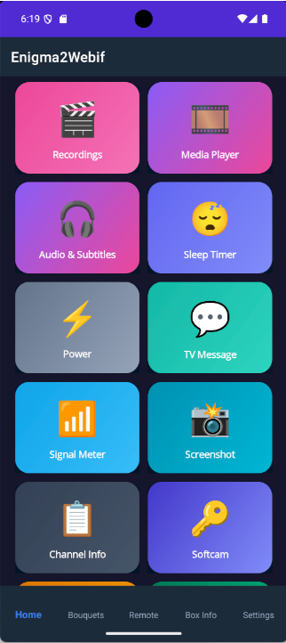 | 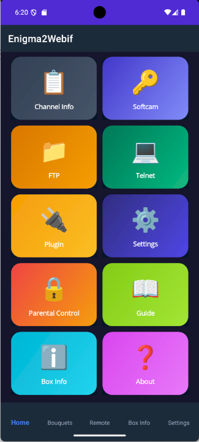 |

### 📺 Bouquets, Channels & EPG
| Bouquet | Bouquet Editor | Bouquet Editor (2) |
|:---:|:---:|:---:|
|  |  | 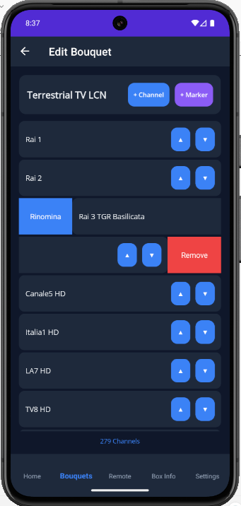 |

| Channels | Channels Preview | Channels List |
|:---:|:---:|:---:|
| 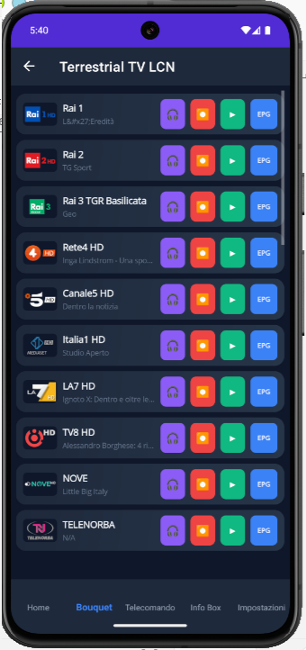 |  |  |

| Channels List Edit | Channels List EPG Now | EPG |
|:---:|:---:|:---:|
|  | 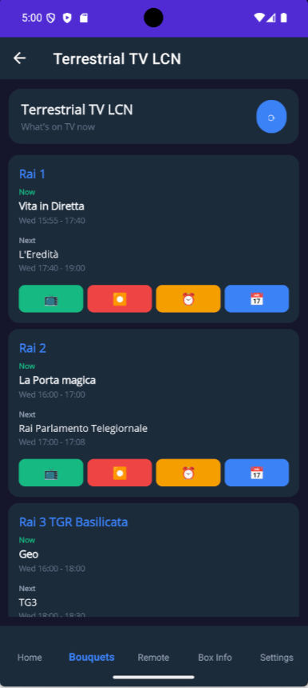 | 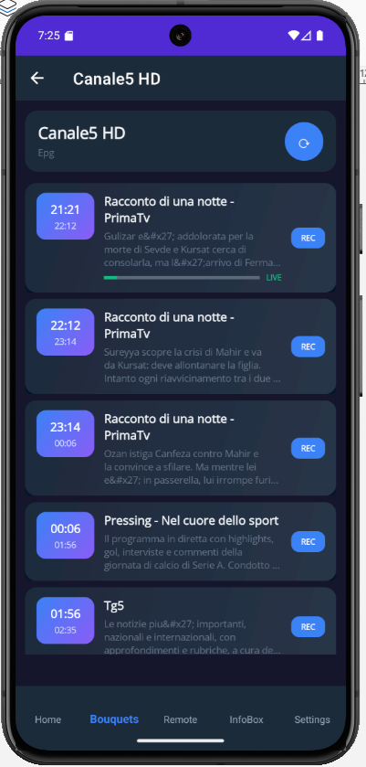 |

| EPG Grid | Event Details | Search |
|:---:|:---:|:---:|
| 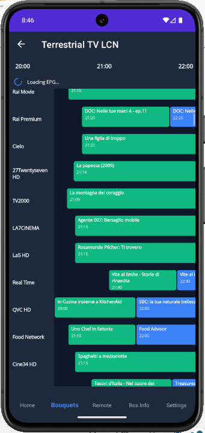 |  |  |

### 🎬 Streaming & Media
| Live TV | Media Player | Audio & Subtitles |
|:---:|:---:|:---:|
|  | 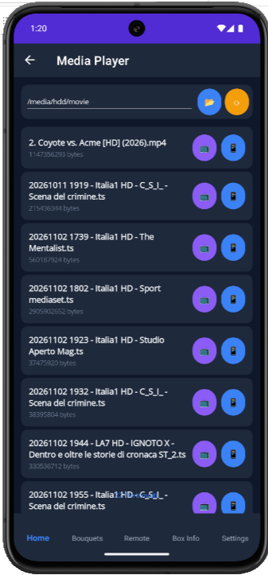 |  |

| Channel Info | Recordings |
|:---:|:---:|
| 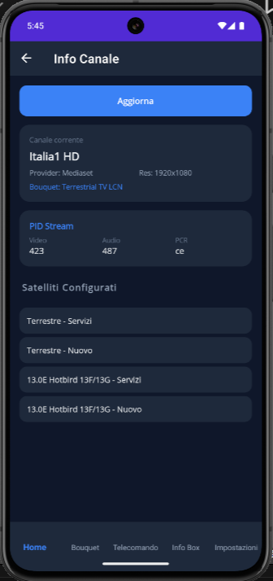 | 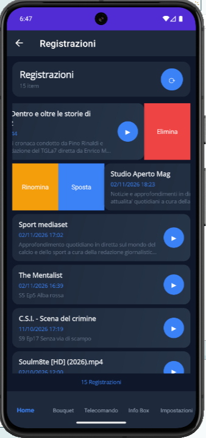 |

### 🎛️ Remote & Control
| Remote | Remote Settings | Remote Settings (2) |
|:---:|:---:|:---:|
| 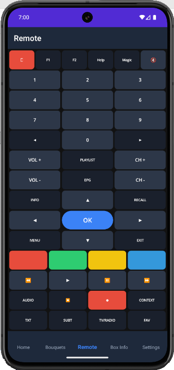 |  | 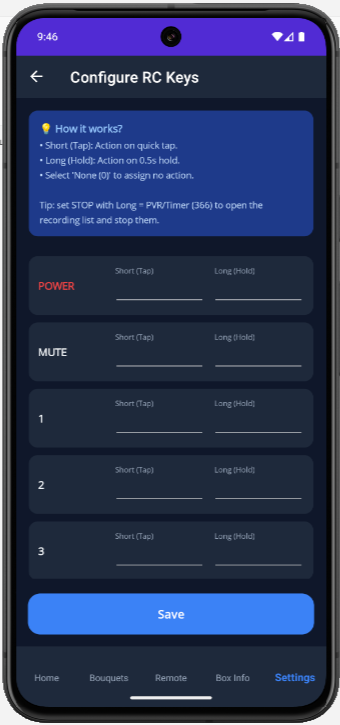 |

| Power Menu | OSD Message | Sleep Timer |
|:---:|:---:|:---:|
| 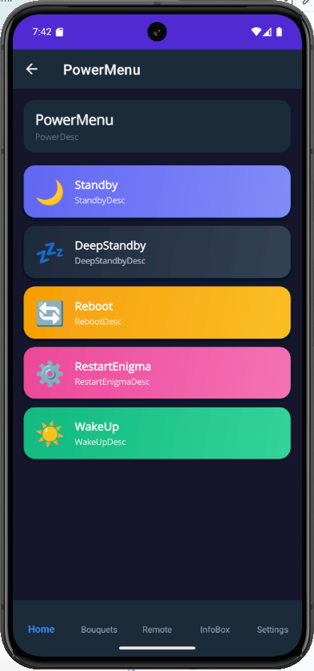 | 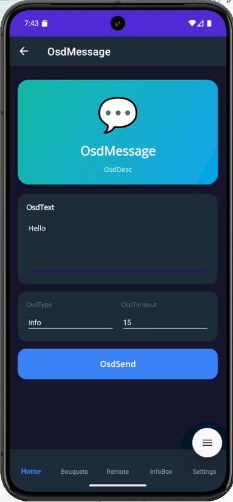 | 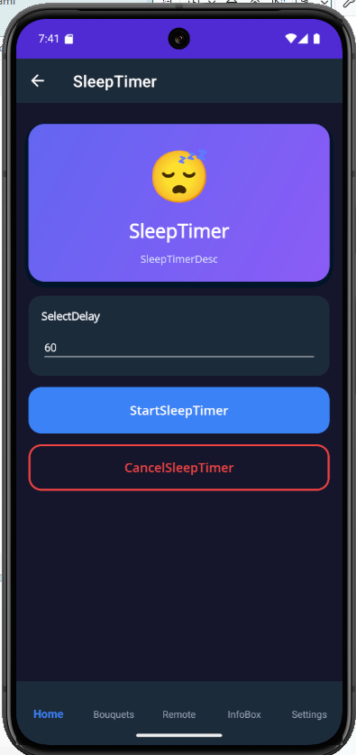 |

### ⏰ Timers
| Timers (1) | Timers (2) |
|:---:|:---:|
| 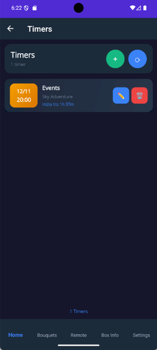 |  |

### 🛠️ Tools
| Screenshot | Telnet | FTP |
|:---:|:---:|:---:|
|  | 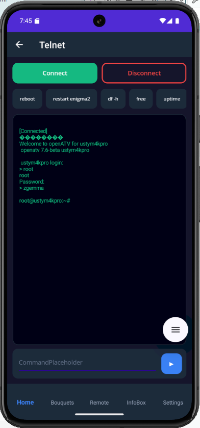 |  |

| Plugin Manager | Signal Meter | Signal Meter (2) |
|:---:|:---:|:---:|
| 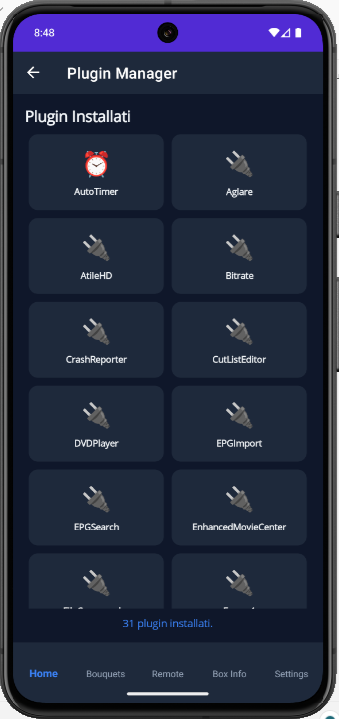 | 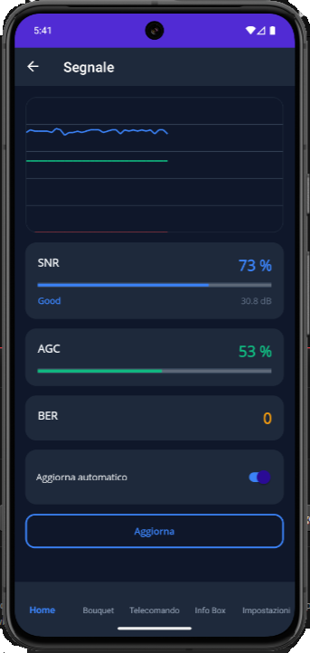 | 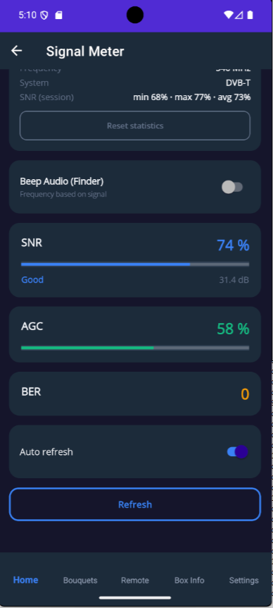 |

| Maintenance | Box Info | Box Info (2) |
|:---:|:---:|:---:|
|  |  |  |

### ⚙️ Settings & Info
| Settings | Settings (Theme + Backup) | Material You |
|:---:|:---:|:---:|
| 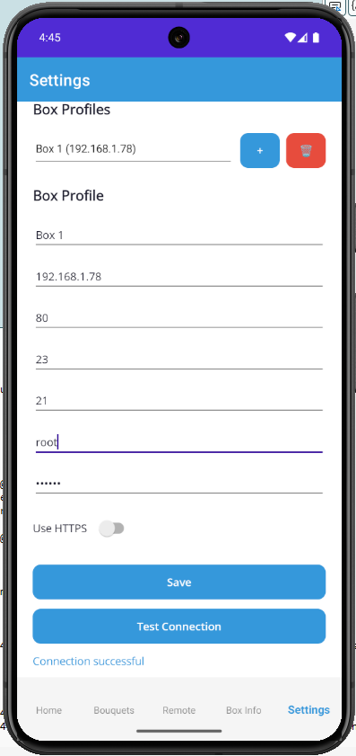 |  | 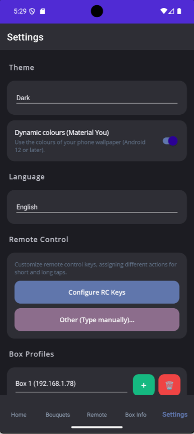 |

| Parental Control | Guide | About |
|:---:|:---:|:---:|
|  | 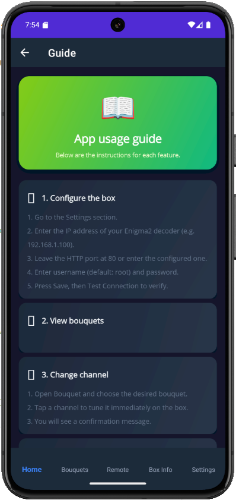 | 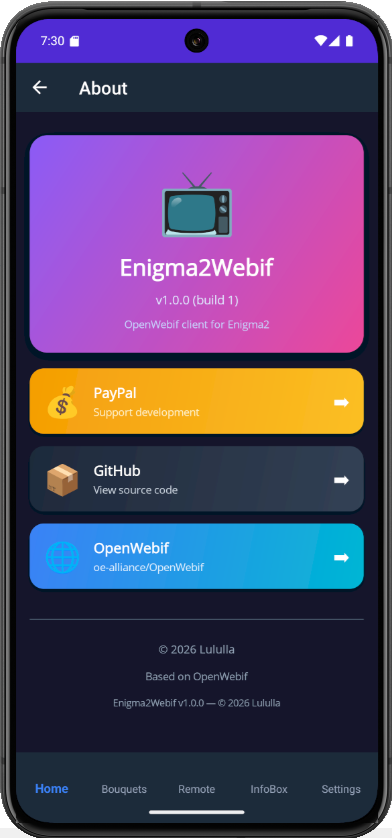 |

---

## 🚀 Installation

1. Download the latest APK from the **Releases** section.
2. Enable **Install from unknown sources**.
3. Open the APK and install.
4. Launch the app and configure your box in **Settings**.

**Optional — Plugin Launcher.** To use *Plugin Run*, open **Plugin Manager** and tap **Install launcher**: the app uploads a small plugin to `/usr/lib/enigma2/python/Plugins/Extensions/E2WebifLauncher/` over FTP. Restart the GUI when asked (the plugin starts with the session). If you update from an older version, reinstall the launcher once to get v3.

> 🔒 **Security note.** The launcher listens on port **8765** of the box, in plain HTTP, and is protected by a random per-box token stored in the app. This is fine on a home network; do not expose that port to the Internet. The same goes for FTP and Telnet: for remote access prefer a **VPN**, or forward only the HTTP and streaming ports.

---

## 🖥️ Supported Receivers

Any Enigma2 receiver with **OpenWebif 1.5+** installed (Uclan, Vu+, Zgemma, Octagon, Dreambox, Gigablue, Edision...).
**Images tested**: OpenATV, OpenPLi, OpenBH, OpenVision, OpenEight, OpenSPA. The Plugin Launcher has been tested on OpenATV 8.0.1; the audio/subtitle settings use the OpenATV config sections (`Subtitle`, `AutoLanguage`) and may differ on other images.
> ℹ️ **Remote access** (DDNS / VPN) cannot be tested by the author on every network: feedback from users is welcome.

---

## ☕ Support Development

If you find this app useful, consider supporting the development:

👉 [PayPal — belfagor2005](https://paypal.me/belfagor2005)
👉 [Ko-Fi — lululla](https://ko-fi.com/lululla)

---

## 📜 License

GNU General Public License v3.0.

---

*Made with ❤️ for the Enigma2 community*
