# Enigma2Webif

> Android app to control your Enigma2 satellite receiver remotely — a modern mobile client for OpenWebif.


<p align="center">
  <a href="https://ko-fi.com/lululla">
    
  </a>
  <a href="https://paypal.me/belfagor2005">
    
  </a>
</p>

---

## 📱 About

**Enigma2Webif** is a native Android application that brings the power of [OpenWebif](https://github.com/oe-alliance/OpenWebif) to your smartphone. Control your Enigma2 decoder (Uclan, Vu+, Zgemma, Octagon, Dreambox, and many more) with a modern, clean and fast interface.

Built with **.NET MAUI 10** for maximum performance and native look-and-feel.

---

## ✨ Features

### 🎛️ Control
- **Multi-Box** — Save multiple receiver profiles with encrypted passwords (SecureStorage)
- **Full Virtual Remote** — Arrow keys, OK, Menu, Info, EPG, Exit, colored buttons, numbers, playback, TV/Radio/Audio/Video
- **Power Menu** — Standby, Deep Standby, Reboot, Restart Enigma2, Wake Up
- **Sleep Timer** — Programmed shutdown with configurable delay
- **OSD Messages** — Send popup messages to the TV screen
- **Signal Meter** — Live SNR / AGC / BER monitoring with auto-refresh
- **Parental Control** — PIN-protected channels & bouquets with temporary unlock

### 📺 Content
- **Bouquets & Channels** — Browse favorites with picon support and live EPG Now info
- **EPG Guide** — Full program guide with time badges, LIVE indicator and REC button
- **Global Search** — Search channels and programs simultaneously
- **Zap** — Instant channel switching with one tap
- **Timers** — Create from EPG, edit, delete scheduled recordings

### 🛠️ Tools
- **Screenshot** — Capture the box screen in real time
- **Telnet** — Direct terminal with quick commands (reboot, df, free, uptime, ps, ifconfig)
- **FTP** — Browse, download, upload files with built-in text viewer
- **Box Info** — Firmware, kernel, chipset, tuners, HDD, network, RAM

### 🎬 Streaming
- **Live TV** — Watch the current channel via VLC or external player (transcoded stream on port 8001)
- **Recordings** — Browse and play recorded movies from the box HDD
- **Playlist Support** — Automatic extraction from .m3u/.m3u8 files
- **Smart Launcher** — 4-level fallback: VLC → VLC (data only) → chooser → browser

### 🌍 Experience
- **5 Languages** — Italian, English, German, French, Spanish (live switch)
- **Dark Theme** — Modern dark UI with gradient tiles
- **Integrated Guide** — 15-section step-by-step help
- **About Page** — Credits, source code, support links

---

## 📸 Screenshots

### 🏠 Home & Navigation

| Home (1) | Home (2) | Home (3) |
|:---:|:---:|:---:|
| 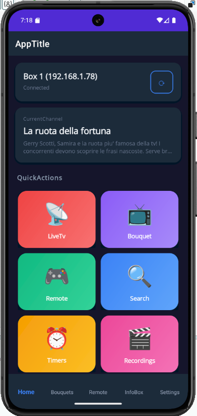 | 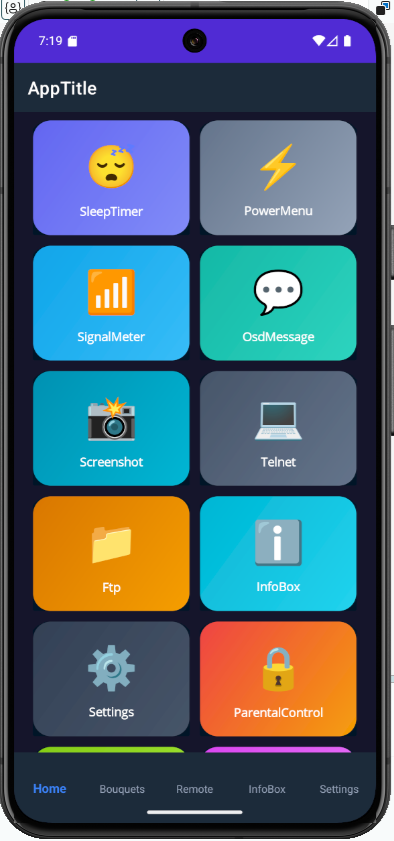 | 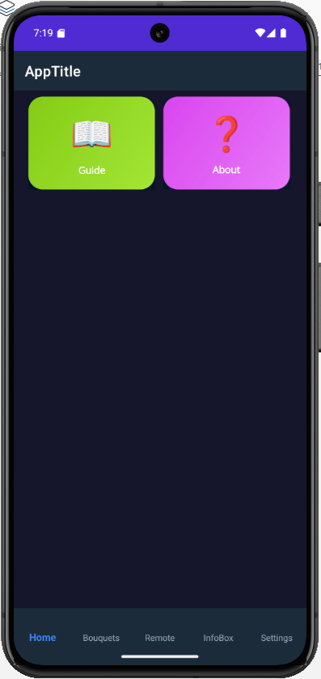 |

### 📺 Content

| Bouquet | Channels | EPG |
|:---:|:---:|:---:|
| 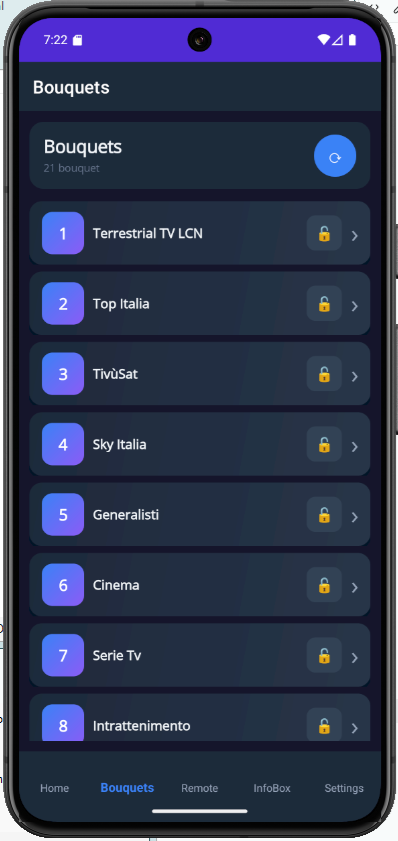 | 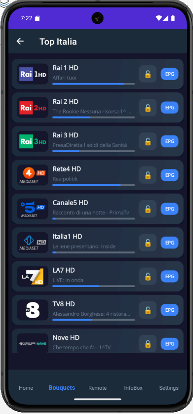 |  |

| Search | Live TV | Recordings |
|:---:|:---:|:---:|
|  | 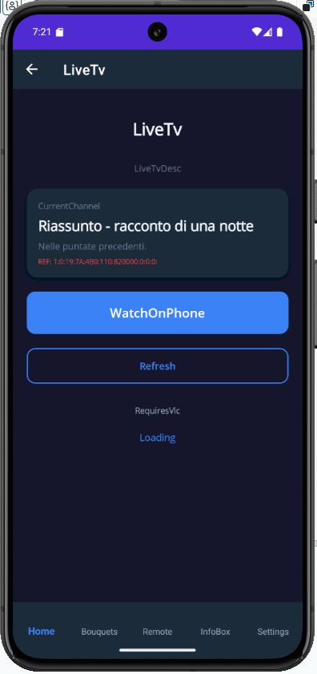 | 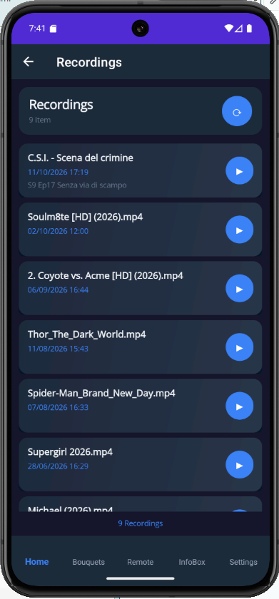 |

### 🎛️ Control

| Remote | Power Menu | Sleep Timer |
|:---:|:---:|:---:|
|  |  | 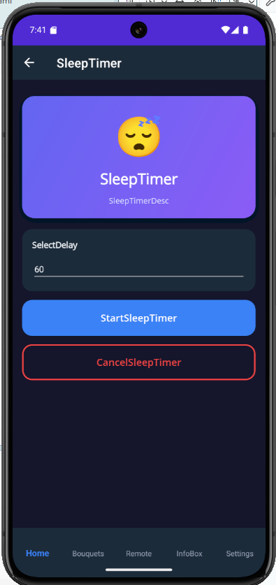 |

| Timers (1) | Timers (2) | OSD Message |
|:---:|:---:|:---:|
| 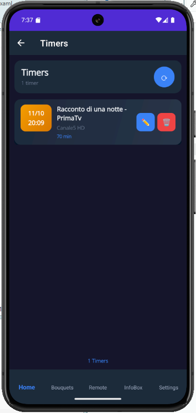 | 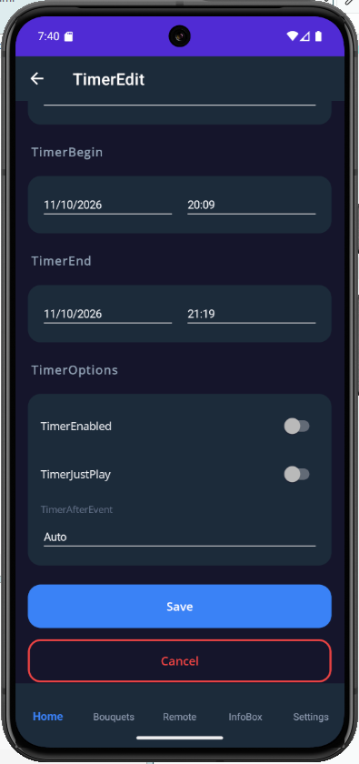 | 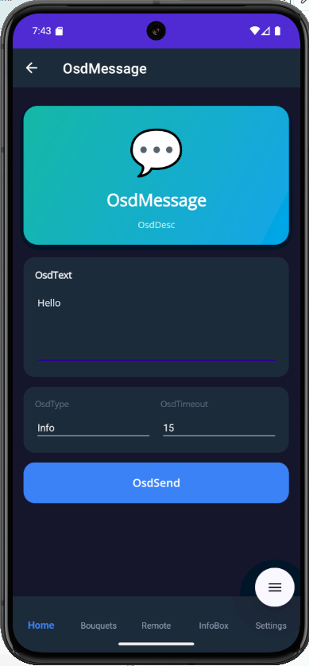 |

| Signal Meter | Parental Control |
|:---:|:---:|
| 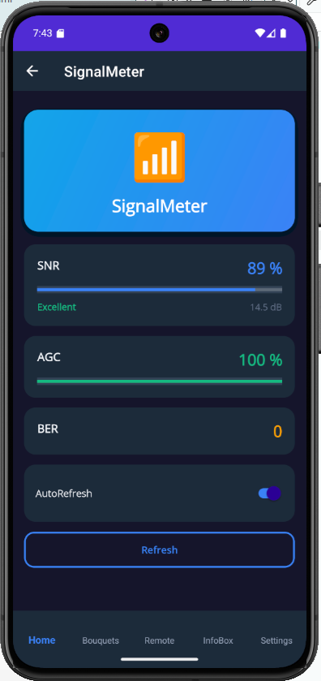 | 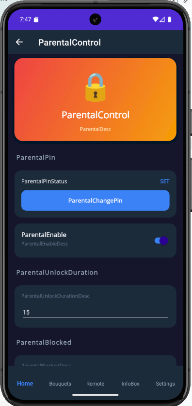 |

### 🛠️ Tools

| Screenshot | Telnet | FTP |
|:---:|:---:|:---:|
|  |  |  |

### ℹ️ Info & Settings

| Box Info (1) | Box Info (2) | Settings |
|:---:|:---:|:---:|
|  |  |  |

| Guide | About |
|:---:|:---:|
|  |  |

---

## 🚀 Installation

### Requirements
- Android 8.0 (API 26) or higher
- Enigma2 receiver with OpenWebif enabled
- Same Wi-Fi network as your box

### Download
1. Download the latest APK from the **Releases** section
2. On your phone, enable **Install from unknown sources** for your file manager
3. Open the APK and install
4. Launch the app

### First Setup
1. Open **Settings** tab
2. Tap `+` to add a new box profile
3. Enter:
   - **Name** (e.g. "Living Room")
   - **IP Address** (e.g. `192.168.1.100`)
   - **Ports** (default: HTTP 80, Telnet 23, FTP 21)
   - **Username** (default: `root`)
   - **Password** (your box password)
4. Tap **Save**, then **Test Connection**

---

## 📖 User Guide

### 🏠 Home
The starting point. Shows:
- **Box name** and **connection status**
- **Current channel** with program info
- **18 gradient tiles** organized in 5 groups: TV, Recordings, Controls, Tools, Info

Tap the ⟳ button to refresh status.

### 📺 Bouquets & Channels
1. Open **Bouquet** tab
2. Tap a bouquet to see its channels
3. Each channel shows:
   - **Picon** (channel logo)
   - **Channel name**
   - **EPG Now** program with time range and live progress bar
4. **Tap a channel** → immediate zap
5. **Tap the lock icon** → block/unblock (requires PIN)
6. **Tap the EPG button** → full program guide

### 🔍 Search
- Search channels and programs at the same time
- Toggle **Channels** / **Programs** with checkboxes
- Tap a channel to zap, tap a program to open its EPG

### 🎮 Remote Control
Full virtual remote with:
- Numbers 0-9 (top row)
- **Colored buttons** (Red, Green, Yellow, Blue)
- PVR / Arrow keys / Menu
- EPG / OK / Exit
- INFO / TEXT
- Volume ▲▼ / Audio / Mute / Help / Channel ▲▼
- Playback: Rewind, Play, Pause, Forward
- TV / Record / Stop / Radio
- Previous / Next

### ⚡ Power Menu
- **Standby** — Low-power sleep
- **Deep Standby** — Full shutdown
- **Reboot** — Restart decoder
- **Restart Enigma2** — Restart GUI only
- **Wake Up** — Wake from standby

### ⏰ Timers
- Create timers directly from EPG (tap REC button on a program)
- Edit existing timers (name, description, begin/end time, options)
- Delete timers
- Options: Enabled, JustPlay, After event (Nothing/Standby/Deep Standby/Auto)

### 😴 Sleep Timer
Choose a delay (5, 10, 15, 30, 60 minutes) and press **Start Sleep Timer**.
The box goes to standby after the selected time. Press **Cancel** to disable.

### 💬 OSD Messages
Send popup messages to the TV screen:
- Type your message
- Choose type (Info, Warning, Error)
- Set duration (5-60 seconds)
- Tap **Send to TV**

### 📶 Signal Meter
Live monitoring of the current tuner:
- **SNR** — Signal to Noise Ratio with quality label (Excellent/Good/Fair/Weak)
- **AGC** — Automatic Gain Control
- **BER** — Bit Error Rate
- Auto-refresh every 2 seconds (can be toggled off)

### 🔒 Parental Control
Protect channels and bouquets with a 4-digit PIN:
1. Open **Parental Control** from Home
2. Tap **Set PIN** and enter a 4-digit code
3. Enable protection
4. Choose unlock duration (5/10/15/30/60 minutes)
5. Block channels or bouquets by tapping the 🔓 icon in their lists
6. When zapping a blocked channel, enter the PIN → it stays unlocked for the configured duration
7. Use **Re-lock all now** to immediately re-lock all temporarily unlocked items

### 📸 Screenshot
Tap **Refresh** to grab the current screen of your box.

### 🎬 Live TV
Watch the current channel on your phone:
1. Open **Live TV**
2. See the current channel name and program
3. Tap **Watch on phone** → VLC (or another player) opens
4. Requires transcoding enabled on the box (port 8001)

### 🎞️ Recordings
Browse and play recordings from the box HDD:
- Tap a recording to open it in VLC
- Shows title, date, duration, description
- Supports .mp4, .ts and playlist .m3u8/.m3u (for external streams)

### 💻 Telnet
Terminal access to your receiver:
- Tap **Connect**
- Type commands and press **Send**
- Or use **quick buttons**: reboot, restart enigma2, df -h, free, uptime, ls, ps, ifconfig

### 📁 FTP
File manager for your box:
- Tap **Connect**
- Tap folders to enter, `⬆` to go up
- Tap text files (.txt, .sh, .cfg, .json) to view them
- Download and upload supported

### ℹ️ Box Info
Full system dashboard:
- Brand, Model, Chipset
- Firmware, Image, Kernel, Enigma version
- Uptime, RAM usage
- **Tuners** with current state
- **HDD** with capacity and free space
- **Network interfaces** with IP and MAC
- Current service with program details

### ⚙️ Settings
- **Language** — Switch between IT / EN / DE / FR / ES
- **Box Profiles** — Add `+`, delete `🗑`, switch active
- **Connection** — IP, ports, credentials, HTTPS toggle
- Passwords are **encrypted** with Android SecureStorage

### ❓ Guide
Built-in guide with 15 sections explaining every feature.

### ℹ️ About
App info, version, credits, PayPal support link, GitHub repository, OpenWebif project link.

---

## 🖥️ Supported Receivers

Any Enigma2 receiver with **OpenWebif 1.5+** installed, including:

- Uclan Ustym 4K PRO / Ustym 4K
- Vu+ (Uno, Duo, Solo, Zero, Ultimo)
- Zgemma (H.Series, H7, H9, H10, H11)
- Octagon (SF4008, SF8008, SX88)
- Dreambox (DM900, DM920, DM ONE, DM TWO)
- Gigablue (Quad, UE, X3)
- Edision (OS Mio+, OS Nino+)
- Mutant, AX HD, Formuler, Amiko...

**Images tested**: OpenATV, OpenPLi, OpenBH, OpenVision, OpenEight, OpenSPA

---

## 🌍 Languages

- 🇮🇹 Italiano
- 🇬🇧 English
- 🇩🇪 Deutsch
- 🇫🇷 Français
- 🇪🇸 Español

Want to add your language? Open an issue!

---

## 🐛 Bug Reports & Feature Requests

Found a bug or have an idea? Open an issue on GitHub:

👉 [https://github.com/belfagor2005/Enigma2Webif/issues](https://github.com/belfagor2005/Enigma2Webif/issues)

Please include:
- App version
- Android version
- Receiver model + image
- Steps to reproduce
- Screenshots if possible

---

## ☕ Support Development

If you find this app useful, consider supporting the development:

👉 [PayPal — belfagor2005](https://paypal.me/belfagor2005)

Every coffee helps! ☕

---

## 📜 License

This project is licensed under the **GNU General Public License v3.0**.

See the [LICENSE](LICENSE) file for details.

---

## 🙏 Credits

- **Author**: Lululla
- **Based on**: [OpenWebif](https://github.com/oe-alliance/OpenWebif) by the OE-Alliance team
- **Icon**: Custom design
- **Special thanks** to the Enigma2 community

---

## ⚠️ Disclaimer

This app is provided "as is", without warranty of any kind. Use at your own risk.

The author is not responsible for any damage to your receiver or data loss.

Enigma2 and OpenWebif are trademarks of their respective owners. This app is not affiliated with any of them.

---

*Made with ❤️ for the Enigma2 community*
```
