# Enigma2Webif

> Android app to control your Enigma2 satellite receiver remotely — a modern mobile client for OpenWebif.

  
  

---

## 📱 About

**Enigma2Webif** is a native Android application that brings the power of [OpenWebif](https://github.com/oe-alliance/OpenWebif) to your smartphone and Android TV.

Control your Enigma2 decoder (Uclan, Vu+, Zgemma, Octagon, Dreambox, and many more) with a modern, clean and fast interface. Built with **.NET MAUI 10** for maximum performance and native look-and-feel.

---

## 🆕 What's new in v1.8.5

- 🚀 **Plugin Launcher & Plugin Run**: start any plugin installed on the box and use it from the phone — live screen of the box, full remote, command log. The launcher is installed on the box by the app itself (over FTP).
- 💬 **Audio & Subtitles, rebuilt**: real subtitle list, open/close the box subtitle menu, **box remote with a live, zoomable picture of the box screen**, box subtitle settings and **Auto Language** (preferred audio/subtitle languages).
- 📁 **FTP, rebuilt**: symbolic links, rename / move (also across disks) / delete / download / properties, new folder, upload, **text editor with automatic `.bak`**, multi-select, safety protections.
- 📺 **More robust streaming**: stream check before playing, automatic fallback to the box direct stream, **Retry** button, recovery from errors during playback.
- 🛰️ **Technical Details** of the current channel (PIDs, resolution, tuner, frequency, channels on the same transponder) and richer **Signal Finder** (tuning details + SNR min/max/average).
- 📅 **Calendar reminders** for timers and programs (no permission needed).
- 🎨 **Material You** dynamic colors on Android 12+ (optional).
- 🔍 **Pinch-to-zoom** on the box screenshots.
- 📖 **Guide reorganised** in the order of the app, with automatic chapter numbers.

See the full list in the [Releases](../../releases) page.

---

## ✨ EVERYTHING THE APP CAN DO (v1.8.5)

Here is the complete list of the features included in Enigma2Webif:

### 🌐 Box & Connection Management
- **Multi-Box Support**: Configure and switch between multiple decoders.
- **Secure Storage**: Passwords are saved securely using Android SecureStorage.
- **Port Configuration**: Customize HTTP, Telnet, and FTP ports for each box.
- **Connection Status**: Live banner showing online/offline status and current channel.
- **Backup & Restore**: Export/Import all profiles, remote mappings, and parental settings to a JSON file.
- **In-App Updates**: Automatic check for new GitHub releases on startup and manual check in Settings.
- **Maintenance Dashboard**: Real-time monitoring of RAM, Disk, and CPU Temperature with Gauge animations. Includes "RAM Boost" (drop_caches), GUI Restart, Box Reboot, and Standby actions directly from the app (with Telnet/HTTP fallback).

### 📺 Channels, Bouquets & EPG
- **Bouquet List**: Browse all your satellite and IPTV bouquets with lazy loading and local caching.
- **Channel List**: View channels with **smart in-memory cache** (5 min) to avoid reloading from the box every time. Includes a manual "Force Refresh" button.
- **Lightning Search**: A fixed search bar at the top of the Channels list to instantly filter channels without lagging the UI (debounced).
- **Edit Mode**: Toggle Edit Mode to Reorder (Up/Down), Rename, or Delete bouquets and channels directly from the app.
- **Bouquet Editor**: Create/Delete bouquets, add markers, move channels between folders.
- **EPG Grid (Palimpsest)**: A 2D scrollable TV guide spanning 12 hours, with synchronized horizontal and vertical scrolling.
- **EPG Details**: View full program descriptions, live progress bars, start times, and the **day of the week** (e.g. MON, TUE).
- **Timer Feedback**: Programs with an active timer show a **clock icon (⏰)** directly in the EPG list and Channel list.
- **Find Similar**: Discover similar programs based on the current event (falls back to a title search when the box gives no data).
- **Global Search**: Search for both Channels and Programs simultaneously, with filters for Movies, Sports, or News.
- **Voice Search**: Use your phone's microphone to search for channels (e.g., say "Rai 1").
- **Picons Support**: Automatically loads channel logos from the box.
- **Technical Details** *(new)*: tap 🛰️ on the current channel card to see video/audio/PCR/PMT/teletext PIDs, resolution, tuner and signal, **frequency, polarization, symbol rate, FEC and system**, and the **list of channels on the same transponder** (tap to tune). Frequencies are read from the box channel database (`lamedb`) over FTP.

### 🎬 Streaming, Media & Recordings
- **Media Engine (Shiny)**: **Shiny.Maui.Controls.MediaElement** for rock-solid stability and PiP support.
- **True Picture-in-Picture (PiP)**: The video player enters PiP mode showing the actual TV stream in a floating window.
- **Built-in Video Player**: Watch TV directly in the app with transcoding profiles (Low is the default for immediate compatibility).
- **Robust streaming** *(new)*: before opening the player the app checks that the stream really delivers data; if the transcoder refuses, it **falls back to the box direct stream**; if it fails, a **Retry** button appears. Errors during playback are recovered the same way. Only one stream is opened at a time (one tuner, one encoder).
- **Home Mini Player**: A small video widget on the Home screen to keep an eye on the current channel while browsing the app.
- **Listen Mode (Headphones)**: Route the TV audio to your phone's headphones (or Bluetooth) without disturbing the others in the room.
- **Background Media Session**: Native Android Play/Pause/Stop controls in the notification tray.
- **Media Player Watchdog**: If the app is closed during playback, it asks to restore the TV channel on next launch.
- **Audio & Subtitles** *(rebuilt)*:
  - Switch the audio track in real time; see the subtitles of the channel (DVB / Teletext) with language and type.
  - **Open / Close the box subtitle menu** from the app, and drive it with a **built-in box remote (▲ ▼ ◀ ▶ OK EXIT) showing a live picture of the box screen** — pinch to zoom.
  - Edit the **box subtitle settings** (size, position, colors, delay…) and the **Auto Language** settings (preferred audio 1-4 and subtitle 1-4 languages); every change is saved on the box.
  - If SubsSupportPro is installed on the box, the same key opens it.
- **Subservices**: Support for multistream channels (alternative commentators/feeds).
- **Media Player (HDD)**: Browse your box's hard drive via FTP and play files directly on the TV or on your phone.
- **Recordings Manager**: View, play, rename, move, copy, or delete recordings on your box; multi-select and batch download with a live progress bar.
- **Export M3U**: Save IPTV bouquets as `.m3u` files and share them via the native Android share menu.

### 🎛️ Remote, Power & Automation
- **Advanced Virtual Remote**: Full physical layout with Haptic Feedback and Short/Long press support.
- **Button Setup**: Remap your hardware color keys (Red, Green, Yellow, Blue) with over 20 Enigma2 native actions.
- **Custom RC Mapping**: Reassign what code is sent for 40+ remote buttons.
- **Power Menu**: Standby, Deep Standby, Reboot, Restart GUI, Wake Up, and Wake-on-LAN (WOL).
- **Power Timers** and **Sleep Timer**.
- **OSD Messages and Questions**: Send popup messages or a Yes/No question to the TV and get the answer on your phone.
- **Signal Finder**: A **circular gauge** (3 concentric rings for SNR, AGC, BER) with smooth animations, the OpenATV AGC estimation fix and a real-time audio beeper. New **Tuning details** card: channel, tuner, satellite, frequency, symbol rate, FEC, system and **SNR minimum / maximum / average** of the session — handy when aiming the dish.

### 🔌 Plugins & Advanced Tools
- **Plugin Launcher** *(new)*: the app installs a small launcher plugin on the box (over FTP; one GUI restart is needed the first time). Each box has its own random token, and the app recovers it automatically if you reinstall the app.
- **Plugin Run** *(new)*: start any launchable plugin from the Plugin Manager and use it from the phone — **live screen of the box** (pinch to zoom), color keys + Info + Menu always visible, **full remote**, enlargeable monitor with quick keys, **command log**, automatic return to the list when the plugin closes on the box. Forces landscape for a comfortable view.
- **Plugin Manager**: Scan installed plugins via FTP, launch them (▶), and edit AutoTimer and EPGRefresh configurations.
- **FTP Client** *(rebuilt)*: browse the box file system with **symbolic links**, view and **edit text files** (an automatic `.bak` copy is written before saving), **rename, move (also across disks), delete, download to the phone, properties**, **new folder**, **upload**, **multi-select**. System folders are protected and risky deletions ask for a second confirmation.
- **Telnet Client**: Auto-login terminal with quick command buttons (reboot, df -h, free, etc.).
- **Softcam Integration**: Quick access to open OSCam and CCcam web interfaces (with editable ports).
- **Screenshot Tool**: Capture your TV screen (All/Video/OSD, JPG/PNG, Native/UHD/WQHD). Share via the Android menu.
- **System Info / Box Info**: PIDs, satellites, tuner status, firmware, kernel, CPU, RAM, network and HDD.

### ⏰ Timers
- **King System for Timers**: The Box is the absolute truth. No local cache, no duplicates. The app waits for Box confirmation and updates all screens (EPG, Home, Channel List, NowOnTv) instantly.
- **Manual and EPG Timer Creation** with folder and advanced options (Just Play, Always Zap, PiP Zap); duplicate prevention.
- **NowOnTv Quick Actions**: Zap, Record Now, Timer for Next, Open EPG on every card.
- **Timer Notifications**: Push notifications 2 minutes before a timer starts and 1 minute before it ends/fails.
- **Calendar reminders** *(new)*: add any timer or program to your phone calendar (📅). The calendar app opens with the event pre-filled — no permission needed, you confirm.

### 📱 Integrations & UI
- **Customizable Home**: Hide/Show, reorder, and restore default tiles.
- **Parental Control**: PIN-protect specific channels and bouquets.
- **Home Assistant Webhook**: Send JSON events to your smart home when you change channels or start recordings.
- **Home Screen Widget**: Current channel and EPG description.
- **Android TV Support**: Compatible with Android TV and Leanback.
- **Responsive Layout**: Home grid scales to 3 or 4 columns on tablets and foldables.
- **Light / Dark Theme** and **Material You** *(new)*: on Android 12+ the app can use the colors of your wallpaper (Settings → Dynamic colors, then restart the app).
- **5 Languages**: 100% translated in Italian, English, German, French, and Spanish.
- **Integrated Guide**: A fully translated 48-chapter manual, in the order of the app, with real examples.
- **Crash Reporting**: Sentry integrated (Release only).

---

## 📸 Screenshots

### 🏠 Home & Navigation
| Home (1) | Home (2) | Home (3) |
|:---:|:---:|:---:|
| 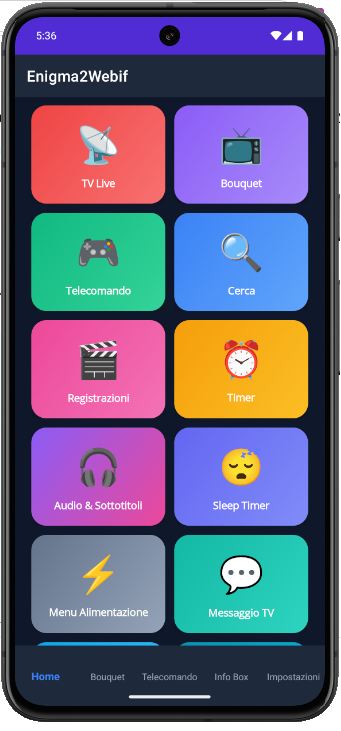 |  |  |

### 📺 Bouquets, Channels & EPG
| Bouquet | Bouquet Editor | Bouquet Editor (2) |
|:---:|:---:|:---:|
| 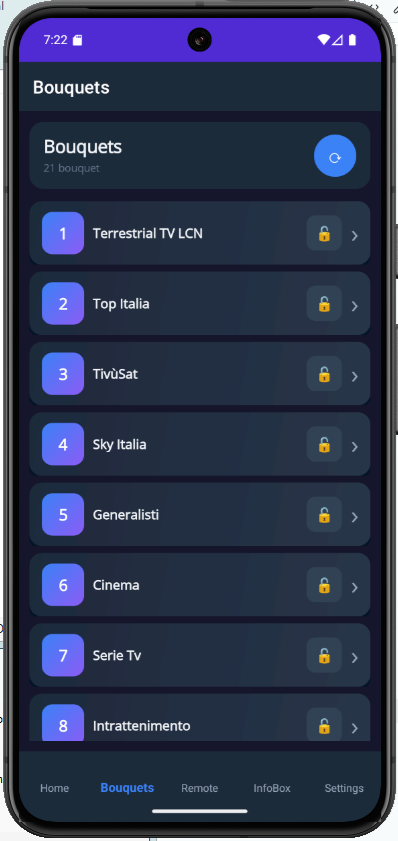 | 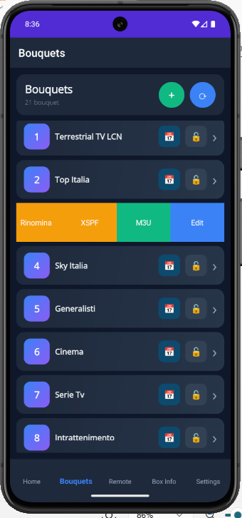 |  |

| Channels | Channels Preview | Channels List |
|:---:|:---:|:---:|
|  | 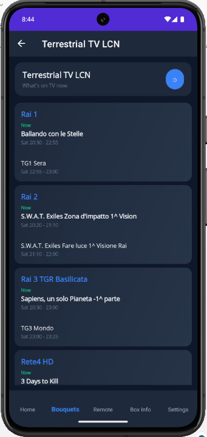 | 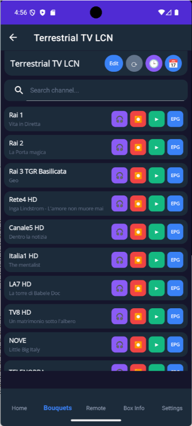 |

| Channels List Edit | Channels List EPG Now | EPG |
|:---:|:---:|:---:|
| 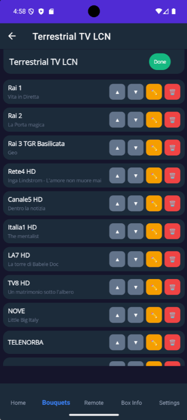 |  |  |

| EPG Grid | Event Details | Search |
|:---:|:---:|:---:|
|  | 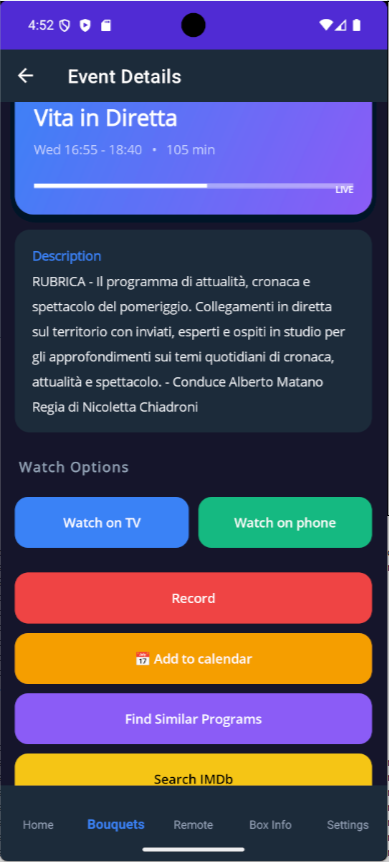 | 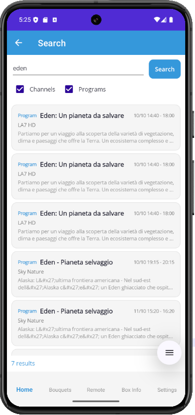 |

### 🎬 Streaming & Media
| Live TV | Media Player | Audio & Subtitles |
|:---:|:---:|:---:|
| 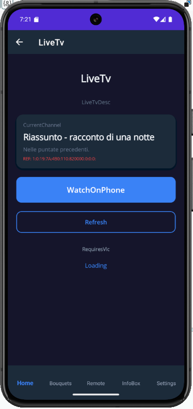 |  | 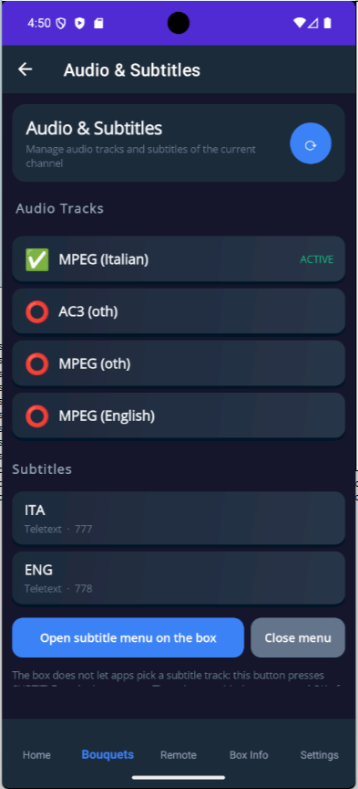 |

| Channel Info | Recordings |
|:---:|:---:|
|  |  |

### 🎛️ Remote & Control
| Remote | Remote Settings | Remote Settings (2) |
|:---:|:---:|:---:|
|  | 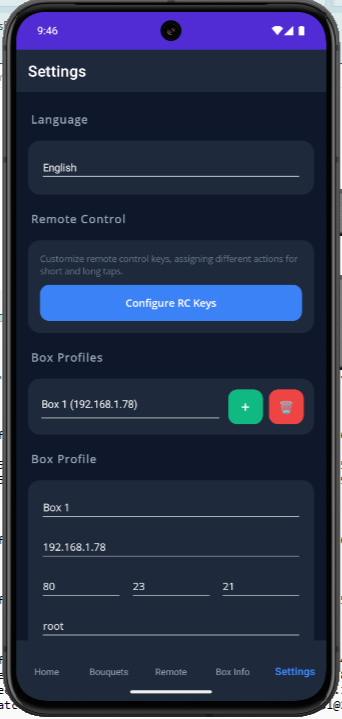 |  |

| Power Menu | OSD Message | Sleep Timer |
|:---:|:---:|:---:|
|  |  |  |

### ⏰ Timers
| Timers (1) | Timers (2) |
|:---:|:---:|
|  | 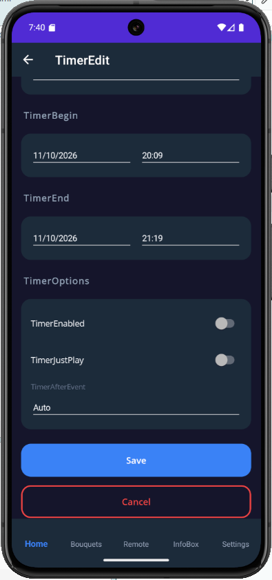 |

### 🛠️ Tools
| Screenshot | Telnet | FTP |
|:---:|:---:|:---:|
| 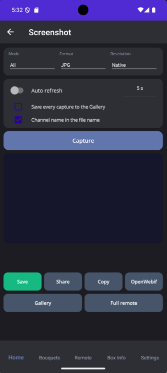 |  | 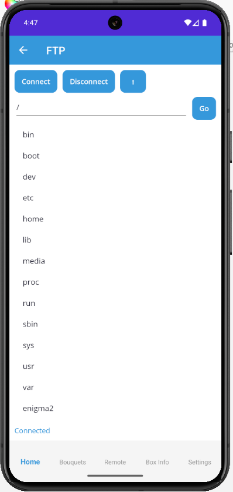 |

| Plugin Manager | Signal Meter | Signal Meter (2) |
|:---:|:---:|:---:|
|  |  |  |

| Maintenance | Box Info | Box Info (2) |
|:---:|:---:|:---:|
| 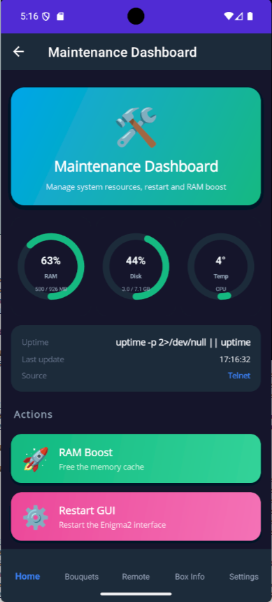 | 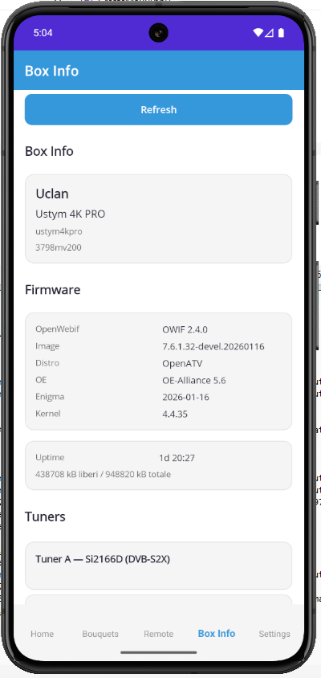 | 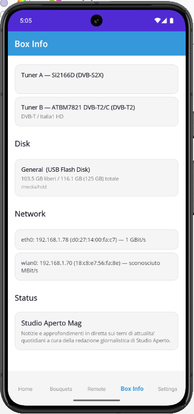 |

### ⚙️ Settings & Info
| Settings | Settings (Theme + Backup) | Material You |
|:---:|:---:|:---:|
|  | 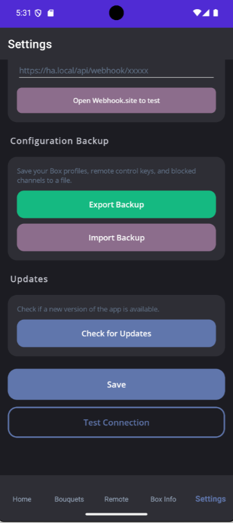 |  |

| Parental Control | Guide | About |
|:---:|:---:|:---:|
| 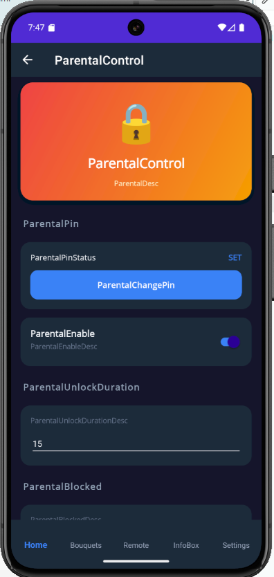 |  |  |

---

## 🚀 Installation

1. Download the latest APK from the **Releases** section.
2. Enable **Install from unknown sources**.
3. Open the APK and install.
4. Launch the app and configure your box in **Settings**.

**Optional — Plugin Launcher.** To use *Plugin Run*, open **Plugin Manager** and tap **Install launcher**: the app uploads a small plugin to `/usr/lib/enigma2/python/Plugins/Extensions/E2WebifLauncher/` over FTP. Restart the GUI when asked (the plugin starts with the session).

> 🔒 **Security note.** The launcher listens on port **8765** of the box, in plain HTTP, and is protected by a random per-box token stored in the app. This is fine on a home network; do not expose that port to the Internet.

---

## 🖥️ Supported Receivers

Any Enigma2 receiver with **OpenWebif 1.5+** installed (Uclan, Vu+, Zgemma, Octagon, Dreambox, Gigablue, Edision...).
**Images tested**: OpenATV, OpenPLi, OpenBH, OpenVision, OpenEight, OpenSPA. The Plugin Launcher has been tested on OpenATV 8.0.1; the audio/subtitle settings use the OpenATV config sections (`Subtitle`, `AutoLanguage`) and may differ on other images.

---

## ☕ Support Development

If you find this app useful, consider supporting the development:

👉 [PayPal — belfagor2005](https://paypal.me/belfagor2005)
👉 [Ko-Fi — lululla](https://ko-fi.com/lululla)

---

## 📜 License

GNU General Public License v3.0.

---

*Made with ❤️ for the Enigma2 community*
